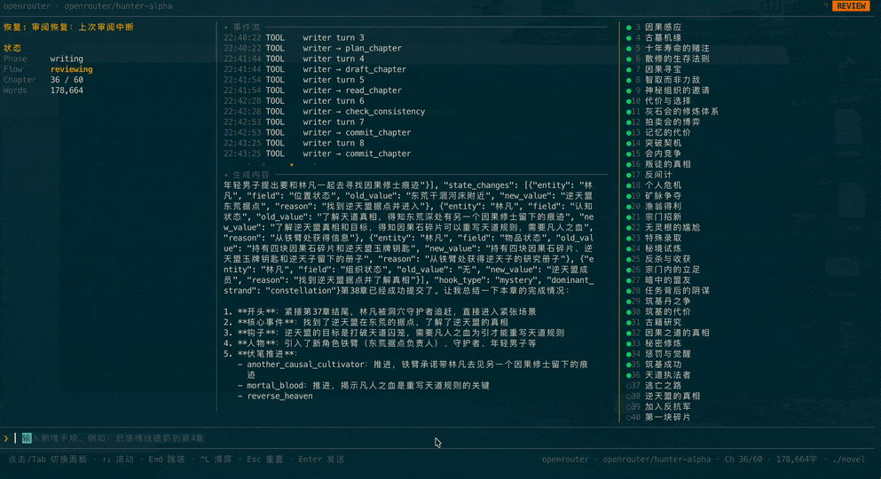
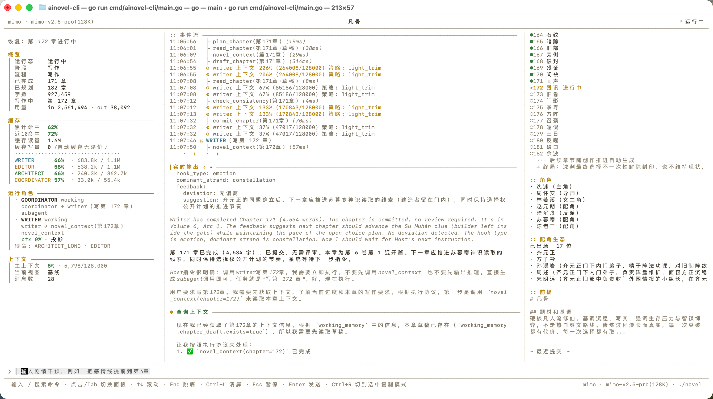

# ainovel-cli

全自动 AI 长篇小说创作引擎。确定性引擎跑完整本书，模型在每个需要判断的位置被精确使用：Engine 按事实路由驱动 Architect / Writer / Editor 三个自主创作代理，语义裁定按需唤醒 Arbiter。从一句话需求到完整小说，全程无需人工干预。

<p align="center">
  
  
</p>

## 特性

- **确定性引擎 + 多智能体协作** — Engine 按事实决策表调度 Architect / Writer / Editor 三个自主创作代理，主循环零 LLM 开销、行为可穷举测试
- **语义裁定可审计** — 选规划师、干预分诊、失败出路等判断由 Arbiter 单次调用完成，每次裁定落盘可回放。越简单越稳定，拒绝复杂编排
- **Step 级断点恢复** — 每个工具执行成功后写入 checkpoint，崩溃后精确到 plan/draft/check/commit 步骤级恢复
- **完整卷弧分层规划** — 初始规划按用户目标一次生成全部卷、全部弧和每弧真实章节，前端可查看完整目录；写作推进时再依据已完成正文、角色状态和反馈修订尚未发生的目录或追加完整新卷，旧骨架项目保留兼容迁移路径
- **相关章节智能推荐** — 每章写作时从伏笔、角色出场、状态变化、关系四个维度自动推荐相关历史章节，配合下一章预告，确保 500+ 章长篇的连续性
- **自适应上下文策略** — 根据总章节数自动切换全量 / 滑窗 / 分层摘要，支持 500+ 章长篇
- **七维质量评审** — Editor 从设定一致性、角色行为、节奏、叙事连贯、伏笔、钩子、审美品质七个维度评审，审美维度细分描写质感/叙事手法/对话区分度/用词质量/情感打动力五项，每项必须引用原文举证
- **用户实时干预** — 写作过程中随时在输入框注入修改意见（无需暂停），系统自动评估影响范围并重写受影响章节
- **可选逐章验收** — 默认仍全自动；需要精细控制时用 `/review on`，每次 `/next` 只放行一个新章节，返工和崩溃恢复不会误消耗许可
- **TUI + Headless 双入口** — 既可在交互界面实时观察和干预，也可在服务器、NAS 或 CI 中无界面持续运行
- **多 LLM 支持** — OpenRouter / Anthropic / Gemini / OpenAI 等等随意切换

## Web 工作台

后续开发以 Electron 桌面版为主，开发启动、测试和打包见 [desktop/README.md](desktop/README.md)。桌面版与本地浏览器工作台复用同一套 Go 引擎、作品目录锁、断点恢复、界面和导出能力。启动 Web 版：

```powershell
ainovel-cli.exe --web
```

默认只监听 `127.0.0.1:17680`，避免与 llama-ui 等常用 8080 端口的应用混用。可用 `--listen 127.0.0.1:9000` 更换端口，`--output <作品目录>` 指定本次工作目录，`--open-browser` 在成功监听后自动打开浏览器。打开终端输出的地址后，可在“设置”中选择 Provider、填写模型和 API Key；已保存的 Key 不会回传到浏览器。“从上游获取模型”可按当前协议查询模型目录并填入候选列表，也可以继续手动输入模型 ID。网页提供创作启动/恢复/暂停、逐章验收、作者干预、实时输出、章节阅读、活动记录、作品切换以及 TXT/EPUB 导出。

Windows 源码环境可双击 `scripts/start-web.cmd`，脚本会构建并运行最新版，成功后打开带本次启动标记的新页面。已有服务占用端口时，可在终端执行 `scripts\start-web.cmd 17681`；启动失败时不会自动打开浏览器。浏览器中残留的 llama-ui 标签页属于先前的 8080 服务，请使用新打开的 17680 页面。同一本书被 TUI 或其他 Web 实例占用时，网页会提示目录锁，可选择“新建作品”。前端资源嵌入 Go 二进制，无需安装 Node.js。浏览器关闭后创作继续运行，停止程序前请先暂停创作。

Web 工作台面向本机单用户使用，不开放局域网或公网监听。活动面板展示当前服务收集的最近 200 条事件，历史审计保存在作品目录中。导入已有小说和阶段共创仍可通过 TUI 使用；网页已经提供规划前多轮共创、项目级 Agent 模型覆盖、持久角色指令、风格语料分析和完整创作门禁。

左侧“项目中心”可新建、重命名、搜索、筛选、归档、恢复和切换项目。新项目保存在独立的 `output/web-books/<项目编号>` 目录，原有 `output/novel` 作品仍可直接打开；暂停并等待当前任务结束后，即可切换到另一项目创作。章节、大纲、风格语料、反馈、审批和验收进度分别保存，刷新或重启不会混合。已归档项目经两次明确确认后可永久删除；当前项目、旧版作品目录和工作台根目录不会被删除。

项目卡片中的“创建副本”会把已有项目完整复制到新目录，可自定义副本名称。副本保留章节、草稿、规划、角色、风格语料、断点、验收记录和历史审计；原项目与副本使用不同的文件和目录锁，后续修改互不影响。副本创建后在项目中心单独打开，旧批次运行许可和待处理干预不会自动执行。复制前需暂停当前操作，并停止源项目后台任务；其他实例占用、目录链接和不完整复制会被拒绝，失败不会留下可打开的半成品。快照历史不随副本重复复制。

“后台任务”支持为非当前项目安排正文批次或恢复已授权批次，每个任务可选择已保存的连接和模型、设置美元预算，并单独查看活动与停止。先在项目中完成规划审批，再切换到其他项目，从项目卡片点击“后台创作”。任务页展开“并发设置”，可调整总并发、默认每连接并发，以及各连接的单独上限，范围均为 1–4096；默认总并发 2、每连接 1，连接覆盖留空时继承默认值。设置会持久保存，可在运行中修改：升限立即补派，降限等待已有任务结束，不强制取消。实际吞吐取决于本机资源和上游额度，4096 是配置上限。同一项目按顺序执行，任务内所有角色和备用模型须使用同一连接。后台任务存在时，前台模型调用与全局模型设置暂时锁定，仍可阅读未运行项目。任务、事件与新增费用分别记账，复制的历史费用不重复计入任务。预算按模型回报的用量检查，在途请求仍可能产生费用；未知价格模型不能提供精确预算保护。

队列保存在工作区 `output/workbench-jobs.json`。重启后继续排队任务，进程中断时正在执行的任务标为 `aborted`，需要检查章节和审批后重新提交。带任务的项目不能切换打开、复制、归档、删除或恢复版本；先在任务中心停止并等待安全退出。单工作区应由一个工作台实例管理。

“模型与连接设置”支持新增和编辑多个连接，每个连接的“模型库”可逐行填写多个模型 ID；上方“添加或编辑模型”用于设置某个模型的上下文窗口与输出上限。保存模型库会保留其他模型的参数、已有 Key 和角色设置，首个连接自动启用，后续新增连接不会改变当前模型。在“创作总览”的“当前默认模型”选择已保存的 Provider / 模型并点击“切换模型”，选择会持久化，后续请求使用新模型。切换前需暂停并等待当前请求、共创与风格分析结束；角色专属模型继续按项目设置执行。删除仍被其他项目角色引用的模型会被阻止，配置写入失败时保留原配置和当前模型。

“版本与恢复”可为当前项目保存命名快照、查看章节/规划/资料的逐行差异，并按预览恢复。恢复前自动保存独立备份，校验快照全部文件及预览指纹；预览后内容变化时需重新预览。恢复保留当前项目身份，撤销旧运行许可与运行队列；中断的恢复事务在再次打开前回滚。版本历史保存在项目的 `meta/versions/`，创建项目副本时不复制版本历史，副本有自己的版本链。桌面版与本地工作台共用该能力。

每个项目可在“创作资料与 Agent”中保存题材、受众、人称、语气、目标字数、风格、标签和写作规则，也可分别覆盖 Architect、Writer、Editor 的 Provider、模型与持久创作指令。“风格语料”支持上传 TXT/Markdown、查看分析进度、删除语料并生成结构化风格画像；修改语料后旧画像会失效，避免把过期风格继续注入正文。

创作流程为：先与共创助手多轮对话，回答题材、目标读者、主角目标、核心矛盾、世界规则、叙事视角、篇幅、结局倾向和禁忌等问题 → 检查并编辑完整创作指令，明确点击“确认创意并生成规划” → 在“规划审核”中阅读完整规划，提交意见让 Architect 修改，直到点击“完全确认当前规划” → 在“章节工作台”设置本批次章节数量（1–100）并开始正文。关键信息未齐时不能确认，确认记录保存在项目内。整批生成完成后暂停，用户可选中已完成章节逐章反馈调整；确认本批次后，再设置并启动下一批。确认记录与规划 fingerprint 绑定，大纲或目录发生变化时旧确认自动失效。章节反馈、批次范围和验收状态均保存在项目目录中。

规划审核阶段即使已通过基础审查或确认，只要尚未生成正文，仍可按修改意见覆盖目录、章节规划和设定；第一阶段的共创记录、完整创作指令及未涉及的创作原则持续保留。部分正文生成后仍可修改后续目录和分卷，但必须重新审查并确认，才能继续生成。已完成正文不会因规划变更或评审建议被自动批量改写，只能在章节工作台选中一章并提交明确修改指令。单章重写完成后暂停，等待用户检查。

章节工作台同步展示全部已规划章节，按“卷”分组，并区分待写、草稿和已完成。可搜索章节或卷名、筛选进度；未生成章节可直接查看事件、悬念和场景安排。旧项目未指定分卷时归入第一卷，已有分层大纲按原有卷弧归属显示。阅读字号可在 16–22px 间调整，实时输出与规划文本也使用更清晰的字号和行距。

“审计中心”可查看指定章节的接纳记录、摘要与评审、规划、角色、世界规则、时间线、伏笔、关系、状态变化、最近决策、checkpoint 和项目 Agent 配置。该接口不返回章节正文或 API Key，便于定位生成中断、事实漂移和恢复链问题。

### Electron 桌面版

桌面版位于 `desktop/`。Electron 主进程会构建并启动 `ainovel-sidecar`，让 Go 引擎只监听随机回环端口，再直接加载同一套 Web 工作台。桌面窗口启用上下文隔离、沙箱并关闭 Node 集成；退出应用时会关闭本次启动的 sidecar。界面和业务操作与 Web 版一致；导出时使用系统“另存为”对话框，项目永久删除后会在下一次同步时清理 SQLite 中的项目索引、共创会话和运行快照。

```powershell
cd desktop
npm install
npm start
```

开发验证与打包：

```powershell
cd desktop
npm test
npm run smoke
npm run dist -- --dir
```

`npm run smoke` 以隐藏窗口启动完整 Go sidecar，检查 Web API、SQLite、窗口加载与退出清理。`npm run dist` 生成安装包，`npm run dist -- --dir` 只生成未压缩应用目录，适合本地验收。

桌面数据保存在 Electron `userData` 目录：

```text
<userData>/
├── ainovel-desktop.sqlite
├── logs/
└── output/web-books/
```

SQLite 保存桌面项目索引、共创会话快照、界面设置和运行状态快照。小说正文、规划、评审和连续性事实仍以 `output/web-books/<项目>` 中的版本化文件为唯一事实源，因此 Web、桌面和命令行可以读取同一套数据。模型 API Key 继续由 Go 引擎保存到既有配置位置，不写入桌面 SQLite，也不会暴露给 Electron 渲染进程。

## 架构

核心设计：**事实层确定，语义层自主**。可枚举的状态迁移由确定性代码执行（Engine + Route）；边界清晰的判断按需咨询 LLM 函数（Arbiter）；开放式创作交给自主的 LLM 循环（Workers）。一句话概括：一个串行确定性 Engine、三个自主 Worker、少数几个按需 Arbiter 函数、一个文件系统事实层。

```
┌─────────────────────────────────────────────────┐
│              Host / Engine（确定性）              │
│  读 Store → Route → 直接运行 Worker → 循环        │
│  启动裁定 / 干预分诊 / 失败僵局 → 按需咨询 Arbiter  │
└────┬──────────┬──────────┬─────────────┬────────┘
     │          │          │             │
 ┌───▼────┐ ┌───▼───┐ ┌────▼────┐   ┌────▼────┐
 │Architect│ │Writer │ │ Editor  │   │ Arbiter │
 │(LLM循环)│ │(LLM循环)│ │(LLM循环)│   │(LLM函数)│
 └───┬────┘ └───┬───┘ └────┬────┘   └─────────┘
     └──────────┼──────────┘
                │ 工具调用（IO + checkpoint）
┌───────────────▼─────────────────────────────────┐
│                   Store                         │
│  Progress / Checkpoint / Outline / Drafts / ... │
└─────────────────────────────────────────────────┘
```

- **Engine** — 每轮从 Store 读事实、按 Route 决策表派发 Worker，执行决定、不参与文学判断；崩溃恢复=读 store 续跑,无会话可恢复
- **Arbiter** — 按需唤醒的语义裁定（选规划师、用户干预分诊、失败/僵局出路），事实进、结构化决策出，每次裁定落盘可审计可回放
- **Workers** — Architect / Writer / Editor 各自独立 context 的自主创作循环，通过 Store 中的工件协作
- **Tools** — 单文件原子 IO + 幂等重放；章节提交使用持久化 Saga + checkpoint，只返事实 JSON，不夹带指令

### 智能体职责

| 角色 | 职责 | 工具 |
|--------|------|------|
| **Arbiter** | 语义裁定：启动选规划师、用户干预分诊、失败/僵局出路 | 无（单次 LLM 调用，输出结构化决策） |
| **Architect** | 生成书名、小说简介、前提、大纲、角色档案、世界规则 | `novel_context` `save_book` `save_foundation` |
| **Writer** | 自主完成一章的构思、写作、自审和提交 | `novel_context` `read_chapter` `plan_chapter` `draft_chapter` `check_consistency` `commit_chapter` |
| **Editor** | 阅读原文，从结构和审美两个层面审阅 | `novel_context` `read_chapter` `save_review` `save_arc_summary` `save_volume_summary` |

### 写作流程

```
用户需求 → Arbiter 选规划师 → Architect 完整规划全部卷弧章节 → Writer 逐章写作 → Editor 弧级评审
              (裁定落盘)                                            ↑                   │
                                                                    ├── 重写/打磨 ◄──────┘
                                                                    │
                                                         Architect 按正文事实修订后续目录/
                                                         追加包含完整章节的新卷
```

每一步"下一个派谁"由 Engine 的 Route 决策表按 Store 事实推导（万级组合穷举测试钉死），不消耗任何 LLM 调用。

Writer 按固定顺序完成每章（写作内容完全自主，工具调用顺序严格）：

1. `novel_context` — 加载上下文（前情摘要、伏笔、角色状态、风格规则、相关章节推荐）
2. `read_chapter` — 回读前文找回语气和节奏
3. `plan_chapter` — 构思本章目标、冲突、情绪弧线
4. `draft_chapter` — 写入整章正文
5. `check_consistency` — 对照状态数据检查一致性（必须在 draft 之后）
6. `commit_chapter` — 提交终稿，落盘事实字段（`arc_end` / `next_chapter` / 反馈池等），下一步由 Engine 按 Route 决策表推导

### 状态迁移规则

系统内部把运行状态拆成两层：

- **Phase** — 大阶段，表示作品目前处于设定期、写作期还是已完成
- **Flow** — 当前活跃流程，表示系统此刻是在正常写作、审阅、重写、打磨还是处理用户干预

#### Phase

`Phase` 采用“只前进不回退”的规则：

```text
init -> premise -> outline -> writing -> complete
  \-------> outline ------^
  \--------------> writing
```

含义：

- `init` — 任务已创建，尚未形成稳定设定
- `premise` — 已保存故事前提
- `outline` — 已保存大纲，可以进入正式写作
- `writing` — 已进入章节创作期
- `complete` — 全书流程结束

规则说明：

- 允许同态更新，例如 `writing -> writing`
- 允许前进，例如 `outline -> writing`
- 不允许回退，例如 `writing -> premise`、`complete -> writing`

#### Flow

`Flow` 只描述写作期内的活跃流程，允许在几个工作流之间切换：

```text
writing   -> reviewing / rewriting / polishing / steering / writing
reviewing -> writing / rewriting / polishing / steering / reviewing
rewriting -> writing / steering / rewriting
polishing -> writing / steering / polishing
steering  -> writing / reviewing / rewriting / polishing / steering
```

含义：

- `writing` — 正常推进下一章
- `reviewing` — Editor 正在评审
- `rewriting` — 处理必须重写的章节
- `polishing` — 处理只需打磨的章节
- `steering` — 正在评估并处理用户干预

规则说明：

- 允许 `writing -> reviewing`，例如章节提交后触发评审
- 允许 `reviewing -> rewriting/polishing/writing`，由评审结果决定
- 允许 `steering -> writing/reviewing/rewriting/polishing`，由干预影响范围决定
- 不允许明显反常的跳转，例如 `rewriting -> reviewing`

这些规则现在由代码中的轻量校验统一约束，避免状态回退或跳到不合理的流程分支。

### 长篇分层规划

本系统采用**指南针约束终局 + 完整卷弧分层规划**。初始规划必须覆盖用户要求的全部范围，不能只给首卷首弧真实章节、把其余卷弧留成骨架：

```
初始规划                           写作推进                         弧/卷边界
┌────────────────────────┐    ┌──────────────────────┐    ┌────────────────────────┐
│ 终局方向（指南针）       │    │ 按完整逐章目录写作    │    │ Editor 弧级/卷级评审    │
│ 全部卷、全部弧           │ →  │ 角色、伏笔与状态持续  │ →  │ 摘要 + 角色快照         │
│ 每弧真实逐章设计         │    │ 由已完成正文校准      │    │ Architect 按事实修订/续卷│
│ 角色 + 世界观            │    │                      │    │ 或按完结条件收束        │
└────────────────────────┘    └──────────────────────┘    └────────────────────────┘
```

- **指南针（Compass）** — 终局方向 + 活跃长线 + 规模估计，每次卷边界由 Architect 更新，故事方向可随创作演化
- **完整规划** — 用户指定卷数、弧数或章数时严格遵守；未指定时自主设计足以承载全书目标的完整结构。每一卷都有弧，每一弧都有真实 `chapters`
- **事实修订** — 写作期允许全量替换目录、修订尚未发生的尾段或追加完整新卷，但不得删除已完成章节、截掉在写草稿或重新制造骨架弧
- **前端完整展示** — 规划页读取完整分层目录，展示全部卷、全部弧和全部章节；历史骨架只作兼容标记，不影响当前完整规划的展示
- **历史兼容** — `expand_next_arc` 仅用于旧版本遗留骨架项目的迁移，不参与新项目初始规划
- **通用节奏模板** — 成长突破弧 / 竞技对抗弧 / 探索发现弧 / 恩怨冲突弧 / 日常过渡弧，每种弧型有参考密度和适用题材映射

### 长篇上下文管理

500+ 章小说采用三级摘要 + 四级压缩管线 + 智能推荐：

```
卷（Volume）→ 卷摘要
└── 弧（Arc）→ 弧摘要 + 角色快照 + 风格规则
    └── 章（Chapter）→ 章摘要（滑窗最近3章）
```

- **分层摘要** — 近处用章摘要，中距离用弧摘要，远处用卷摘要，层层压缩不丢信息
- **相关章节推荐** — 每章写作时从伏笔、角色出场、状态变化、关系四个维度反查历史章节，推荐 Writer 按需回读
- **下一章预告** — 加载下一章大纲，帮 Writer 设计章末钩子和伏笔衔接
- **弧边界检测** — 自动识别弧/卷结束，触发评审、摘要生成和后续目录按事实修订、完整续卷或收束判定

#### 上下文压缩管线

当对话超出模型上下文窗口时，按代价从低到高逐级压缩：

```
ToolResultMicrocompact → LightTrim → StoreSummaryCompact → FullSummary
     清理旧工具结果        截断长文本      store 零 LLM 压缩      LLM 摘要兜底
```

- **StoreSummaryCompact** — Writer 专用，用 store 中已有的章节摘要、角色快照、伏笔台账直接替换旧消息，零 LLM 开销
- **FullSummary 小说定制** — Writer 使用面向叙事连续性的摘要提示词，明确要求保留角色状态、伏笔线索、审稿待修项、风格锚点
- **压缩后恢复包** — FullSummary 后自动注入当前章节计划、大纲和角色快照，防止 Writer 压缩后"失忆"
- **熔断器** — 压缩连续失败时自动跳过并显式告警，采用半开模式，下轮自动重试
- **CJK Token 估算** — 中文 `runes × 1.5`，不会因为 `bytes/4` 低估而导致压缩触发滞后
- **TUI 健康度渐变** — 上下文占用绿(<70%)→黄(70-85%)→红(>85%)实时展示

## 快速开始

```bash
# 一键安装（macOS / Linux，无需 Go）
curl -fsSL https://raw.githubusercontent.com/voocel/ainovel-cli/main/scripts/install.sh | sh

# 安装指定版本
curl -fsSL https://raw.githubusercontent.com/voocel/ainovel-cli/v1.2.3/scripts/install.sh | sh -s -- v1.2.3

# 或通过 Go 安装
go install github.com/voocel/ainovel-cli/cmd/ainovel-cli@latest

# 查看版本 / 更新到最新版本
ainovel-cli --version
ainovel-cli update

# 首次运行，自动进入引导流程（选择 Provider → 输入 API Key → Base URL → 模型名）
ainovel-cli
```

> Windows 或手动安装：前往 [Releases](https://github.com/voocel/ainovel-cli/releases/latest) 下载对应平台的包。
> 安装脚本会从同一 GitHub Release 下载 SHA256 清单，校验通过后才提取并安装二进制。

### Headless 模式

`--headless` 无需 TUI，适合在服务器、NAS、CI 或后台任务中持续运行。它不提供首次配置引导，请先运行一次 `ainovel-cli` 完成配置，或手动创建 `~/.ainovel/config.json`。

```bash
# 使用一句话需求启动新任务
ainovel-cli --headless --prompt "写一本东方玄幻长篇，主角从边陲小城起步"

# 从文件读取需求
ainovel-cli --headless --prompt-file prompt.txt

# 在同一目录恢复未完成的任务
ainovel-cli --headless
```

`--prompt` 与 `--prompt-file` 只能在 Headless 模式下使用，且不能同时指定。模型流式输出写入 stdout，运行事件写入 stderr，完整运行日志保存在作品目录的 `logs/headless.log`。

### Docker

Docker 镜像适合在服务器/NAS 上运行 headless 长任务，也可以用 `-it` 进入 TUI。配置和作品目录建议挂载到宿主机：

```bash
mkdir -p config workspace

# TUI
docker run --rm -it \
  -v "$PWD/config:/root/.ainovel" \
  -v "$PWD/workspace:/workspace" \
  ghcr.io/voocel/ainovel-cli:latest

# Headless
docker run --rm \
  -v "$PWD/config:/root/.ainovel" \
  -v "$PWD/workspace:/workspace" \
  ghcr.io/voocel/ainovel-cli:latest \
  --headless --prompt "写一本东方玄幻长篇，主角从边陲小城起步"
```

也可以用 Compose：

```bash
docker compose run --rm ainovel
docker compose run --rm ainovel --headless --prompt "写一本悬疑短篇"
```

进入 TUI 后，启动阶段支持两种前置交互：

- `快速开始`：一句话直接进入创作
- `共创规划`：与 AI 多轮对话澄清需求，**右侧实时同步整理出的创作指令草稿**；AI 每轮主动提供 1-3 条引导建议，可连续按数字键组合填入，编辑后发送，按 `Ctrl+S` 进入正式创作

两种模式最终都会收敛为同一份创作指令，再进入同一套创作引擎。

已有较长的世界设定或故事大纲时，可在欢迎页直接从文件创建新书：

```text
/start ./outline.md
```

`/start` 会把文件全文作为初始创作要求，交给 Architect 整理为内部设定和完整的卷、弧、章节规划，不会将文件内容当成已完成章节。导入已有小说并续写仍使用 `/import`。

### 管理多本小说

每本小说绑定到启动目录，产物落在 `{cwd}/output/novel/`。换目录启动 = 换一本，`cd` 回去启动 = 自动从最近 checkpoint 恢复。配置 `~/.ainovel/config.json` 全局共享，无需复制。

### 配置文件

首次运行时自动引导生成配置文件 `~/.ainovel/config.json`。进入 TUI 或 Web 工作台后可新增或编辑 Provider、保存多个模型，并为每个模型设置上下文窗口与单次最大输出；保存后立即生效。Web 工作台还可直接从上游读取模型列表和能力元数据。

也可以手动创建配置文件，参考仓库根目录的 `config.example.jsonc`。首次引导也会复制一份到 `~/.ainovel/config.example.jsonc`，方便本机离线查看。

```jsonc
{
  "provider": "openrouter",
  "model": "google/gemini-2.5-flash",
  "reasoning_effort": "medium",
  "providers": {
    "openrouter": {
      "api_key": "sk-or-v1-xxx",
      "base_url": "https://openrouter.ai/api/v1",
      "models": [
        { "name": "google/gemini-2.5-flash", "context_window": 200000, "max_output_tokens": 32768 },
        { "name": "google/gemini-2.5-pro", "context_window": 1000000, "max_output_tokens": 65536 }
      ],
      "extra": {
        "user_agent": "my-client/1.0",
        "headers": { "X-Custom-Client": "my-client" }
      }
    }
  },
  "style": "default"
}
```

#### 配置文件查找顺序（后者覆盖前者）

1. `~/.ainovel/config.json` — 全局配置
2. `./.ainovel/config.json` — 项目级覆盖（可选）

> 项目级 `.ainovel/` 是全局 `~/.ainovel/` 的镜像：同样的结构、只是根目录从家目录换成当前项目。配置放 `./.ainovel/config.json`，写作规则放 `./.ainovel/rules/*.md`（详见下文「去 AI 味与自定义规则」）。该目录含密钥，已默认加入 `.gitignore`。

覆盖规则说明：

- 标量字段按后者覆盖前者，例如 `provider`、`model`、`reasoning_effort`、`style`
- `providers` 和 `roles` 按 key 合并，同名项内部按字段覆盖
- 未填写的字段会继承上层配置，例如项目级配置只写 `base_url` 时会保留全局配置中的 `api_key`
- 不支持用空字符串清空上层已有值；如需清空，请直接编辑更高优先级的配置文件

> ⚠️ `provider`（以及 `roles.*.provider`）的值是 `providers` 里的 **key 名**——一根指针，不是协议名。项目级若把 `provider` 切到一个全局 `providers` 里不存在的账号，必须在项目级同时补上该账号的凭证（`api_key` / `base_url`），否则启动会报“未配置凭证”。

`providers.<name>.models` 为可选模型对象列表：`name` 是传给 Provider 的模型名，`context_window` 是模型专属的上下文压缩窗口，`max_output_tokens` 是单次请求的输出上限，`json_schema` 是原生结构化输出的三态覆盖（`true` 确认支持、`false` 确认不支持、省略则采用适配器能力）。自定义中转或能力取决于具体模型时建议明确填写。旧版字符串数组仍可读取，下一次通过 `/config` 保存时会规范化为对象列表。如果未配置，系统会回退为配置中已经出现过的同 Provider 模型。

上下文窗口按“模型专属值 → 旧顶层 `context_window` → 模型注册表 → 200K 兜底”的顺序解析。它主要影响本地上下文压缩时机，不直接改变远端 API 的真实请求限制。

单次最大输出按“模型专属 `max_output_tokens` → 模型注册表 → 16384 保守兜底”的顺序解析，并静态限制在上下文窗口以内。显式设置的任务级输出预算优先于这个模型级上限。当前没有根据当前 prompt 的实时 token 数动态扣减窗口，所以自定义代理、中转和小模型应填写上游真实支持的值。

如果 Provider 返回 `length` 停止原因，运行日志会出现 `output_truncated` 警告，包含实际输出 token、生效上限、来源和上下文窗口。Agentcore 会尝试继续生成并清理不完整的工具调用，但用户仍应检查章节正文或结构化规划是否被截断。

`stream read error: unexpected EOF` 表示响应流提前中断，与 JSON/章节校验失败分开处理。创作与共创保留流式输出，不自动改为非流式；默认允许连续 15 分钟没有收到新输出，可通过 Provider 的 `stream_idle_timeout` 覆盖。Web 共创整体上限为 30 分钟，用户可随时取消。真正 EOF 表示连接已经关闭，继续等待不能恢复原连接；网络断流后至少等待 15 秒再重试，Worker 最多自动重试 2 次，并遵守上游更长的 `Retry-After`。中断的预览不会拼接到新结果，也不会执行未完成的工具调用。鉴权、参数错误和用户取消不会因此自动重发；原有非流式结构化裁定调用保留其协议。

在“活动记录 → 模型请求”查看当前项目最近的真实模型调用，包含连接与模型、Agent、是否流式、请求与首块时间、耗时、输出上限、用量、停止原因和错误，并可展开请求参数与响应快照。请求详情保存在项目的 `logs/model-requests.jsonl`，重启后仍可查看；API Key、认证头、URL 查询参数等会被隐藏，大内容会有界截断并标记。列表保留最近 500 条请求，日志自动压缩；等待重试期间不会伪造一条已发送请求。历史尚未完成的调用在重启后标记为已中断。

规划时各设定工件分次保存，完整目录中的逐章事件、悬念和场景尽量用精炼要点，减少重复解释和美化缩进；完整章节范围、审计版本和已完成正文保护继续校验。不要靠自动补括号、删除截断尾章或降低必需字段校验来接受半截结果。已有结构化返回会提取完整 JSON 外的代码围栏和说明文字；输出过长应结合上游真实输出上限调整，盲目降低上限会增加 `length` 截断。

`/config` 只用来**编辑 Provider 的定义**（协议 / API Key / Base URL / 模型库），不负责“当前用哪个模型”——切换模型与推理强度请用 `/model`。模型列表支持 `↑↓` 选行、`←→` 选字段、`Enter` 原位编辑模型 ID、上下文窗口或单次最大输出、`Delete` 删除；末尾可直接新增模型，不再进入多层详情页。窗口可输入整数、`128K`、`1M`，留空表示自动解析。保存**就近写回当前生效的那份配置**——项目目录有 `./.ainovel/config.json` 就写它，否则写全局 `~/.ainovel/config.json`——并立即热应用。普通修改只补对应 Provider 段；显式修改模型 ID 时，会在同一次原子写入中同步迁移顶层、角色和 fallback 引用。被引用的模型不能直接删除，需先在 `/model` 切走。API Key 输入始终隐藏。

Provider 详情中的 API Key 与 Base URL 支持原位编辑，已有 Key 只显示首尾脱敏提示；“测试连接”会使用当前草稿和所选模型发送一个最小真实请求，可能产生少量 API 用量，但测试结果不会阻止保存或触发自动降级。任意 `extra`、`extra_body`、`stream_idle_timeout` 等高级配置仍在界面显示的实际配置文件中维护。

`reasoning_effort` 为默认推理强度，可选值为 `off` / `low` / `medium` / `high` / `xhigh` / `max`；省略或空字符串表示沿用模型/provider 默认。`roles.<role>.reasoning_effort` 可按角色覆盖，未配置时继承顶层 `reasoning_effort`。推理强度按“意图 × 能力”生效：配置里存的是你选定的**原始意图**，实际下发时再按该角色**当前模型的能力**钳制——换到能力较低的模型只是当次生效值被钳低，存储的意图不变，切回强模型即自动恢复。TUI `/model` 面板切换 provider、model 或推理强度后，会写回当前生效的那份配置（与 `/config` 一致：项目级存在则写项目，否则写全局）。

`providers.<name>.api` 仅对 `type: "openai"` 或内置 `openai` 生效，用于选择 OpenAI 协议 endpoint：`chat`（默认，`base_url + /chat/completions`）或 `responses`（`base_url + /responses`）。`base_url` 若已包含路径（如火山方舟的 `/api/v3`），该路径会原样保留；只填写域名时默认使用 OpenAI 的 `/v1`。Codex 类代理通常需要配置为 `responses`。

`providers.<name>.extra` 为 provider 级配置，会传给底层 HTTP 客户端，适合配置 `user_agent`、`headers`、`anthropic_beta` 等代理识别字段；`providers.<name>.extra_body` 才是请求体扩展参数，两者不要混用。

## 诊断报告

在 TUI 中输入 `/diag` 可对当前小说的 output 产物进行诊断分析，产出可执行的发现和改进建议。

诊断覆盖四个维度：

- **流程** — 改写循环卡顿、未消费的转向指令、阶段/流程状态异常、章节跳号
- **质量** — 评审维度持续低分、合同履约率、改写率、章节字数异常
- **规划** — 伏笔停滞、指南针过时、大纲耗尽、摘要缺失
- **上下文** — 角色消失、时间线缺口、关系数据停滞

每条发现包含：问题描述、数据证据、改进建议（指向具体的 prompt/flow/config）。

`/diag` 同时会写出一份**已脱敏**的 `meta/diag-export.md`（移除小说正文，仅保留工具调用、错误串、重复次数等行为骨架）。遇到死循环 / 中断类问题，把它贴到 GitHub issue 即可，方便维护者在拿不到本地数据的情况下定位。

## 仿写画像

把参考文章放到当前启动目录的 `simulate/` 文件夹中，然后在 TUI 输入 `/simulate`。系统会递归读取 `.txt`、`.md`、`.markdown` 文件，用 architect 模型分析语料，并写入：

```text
output/novel/meta/simulation_profile.json
```

再次运行 `/simulate` 时，会按 `relative_path + sha256` 跳过未变化文件；如果没有新增或变更内容，会提示“画像已是最新”并且不会调用 LLM。若已有画像且 `simulate/` 中出现新增或修改文章，系统会在原画像基础上继续合成。

也可以导入之前生成的画像，避免重复分析同一批文章：

```text
/simulate
/importsim ./profile.json
```

`/importsim` 只接受本功能生成的 `simulation_profile.v1` JSON，并按语料指纹合并，重复来源会跳过。只导入可信来源的画像文件；导入内容会成为后续 Agent 的上下文参考。画像会以 compact 形式注入 `novel_context`，Architect、Writer、Editor 都能读取；各 Agent 只借鉴结构、节奏、钩子和吸引读者手法，不复制原文表达或专有设定。

## 接纳手动修订

可以直接编辑 `output/novel/chapters/*.md` 中已经完成的章节。系统按已接纳正文的 SHA-256 识别变化，不依赖文件修改时间：

```text
/sync --check   # 只列出发生变化的章节，不调用模型
/sync           # 接纳修改，重建摘要、时间线、伏笔、关系、状态与风格记忆
```

检测到未接纳修改时，恢复创作、继续输入和 `/next` 都会明确要求先执行 `/sync`，避免旧事实继续驱动新章节。`/sync` 不改写用户正文；模型只负责从新正文重新提取完整章节事实和可复用风格偏好，文件版本、状态投影与崩溃恢复均由程序确定性处理。受影响的审阅、弧/卷摘要和角色快照会失效并由 Editor 补建；剧情变化会在续写前交给 Architect 更新后续计划，确认原计划仍适用时也会显式落盘。

## 导入

在 TUI 中输入 `/import <文件路径>` 可把一本已有的小说**语义编译**进项目。一次启动绑定一本书（启动目录下的 `output/novel`），因此导入通常在**新目录启动后的欢迎界面**直接发起——它和"输入需求起新书"、"共创起新书"并列，是起一本书的第三种方式；引擎正在创作时该命令会被拒绝。管线分阶段推进：源文件快照（ingest）→ LLM 识别章节边界（segment）→ 确认切分 → 逐章提取事实（analyze）→ 分层归纳全书前提 / 角色 / 世界观 / 分层大纲 / 指南针（synthesize）→ 发布正式 Foundation 并逐章落盘（publish）。章节边界由模型按语义裁定，不依赖硬编码标题规则；Go 侧只掌管坐标、覆盖校验、幂等与顺序。

典型流程就三步——导入、核对、等完成：

```text
/import ~/我的小说.txt   # ① 启动：面板实时显示进度，切分完成后停下
                         # ② 核对面板列出的全部章节标题：按 y 确认继续
                         # ③ 自动跑完 分析→综合→发布，完成后停在验收，确认无误即可继续创作
```

切分不对？Esc 关面板，用自然语言说明后重新识别（会再次停下核对）：

```text
/import --guide=幕间·X 也是独立章节     # 指导文本可含空格，置于命令最后
```

全部选项（前三个会持久化，崩溃恢复后仍然遵守）：

```text
/import ~/我的小说.txt --yes           # 无人值守：自动接受切分并跑完全程
/import ~/我的小说.txt --story=closed  # 预答"故事状态存疑"：按完结（closed）/未完（open）处理
/import ~/我的小说.txt --continue      # 导入完成后直接接力续写，不停在验收
/import                                # 无参数：从中断处恢复未完成的导入
```

前置与恢复：

- 只能导入到**空书**（没有已完成章节），不支持把另一本书并入已有作品；源文件支持 `txt`/`md`，编码 UTF-8 / GB18030（自动识别，无法可靠解码会明确报错）。
- 每个阶段的产物落在 `meta/import/` 工作区并按输入指纹绑定：中断或失败后重跑 `/import` 只补做缺失部分，不重复调用模型、不用记 "导到第几章了"。存在未完成的导入时，重新启动后的欢迎界面会主动提示进度（如"已分析 210/300 章"）；恢复完成前引擎被门禁挡住，不会把半成品当完整的书续写。模型输出失败的原始响应保存在 `meta/import/failures/` 供排查。
- 故事状态被综合判定为 `uncertain` 时管线停下，用 `--story=open|closed` 明确后重跑即可。
- 默认发布完成后设一次验收 Hold，等你确认再续写；`--continue` 跳过该 Hold（review 模式下仍需 `/next`）。
- 导入的三个语义函数可在配置 `roles` 中指定独立模型档位（见[按角色使用不同模型](#按角色使用不同模型)）。

> 原文会逐字落盘为已完成章节，因此导入适合"续写同一本书"。如果只想借鉴设定做全新创作，请用普通方式起一本新书、在需求里描述想要的风格设定。

## 导出

在 TUI 中输入 `/export` 可把已完成的章节合并导出，默认 TXT，写到 `{小说目录}/{书名}.txt`。导出是只读操作，写作中途也可以随时拿"现阶段成品"，不影响引擎运行。

Web 工作台和 Electron 桌面版也可从任一项目卡片导出 TXT 或 EPUB，包括当前项目、其他未归档项目以及归档项目。尚未完本的项目会按 `progress.completed_chapters` 导出最新章节，已提交终稿但尚未完成的当前章和普通草稿不会进入文件。导出不依赖模型连接，暂停或模型配置失效时仍可使用；Web 版交给浏览器下载，桌面版打开系统“另存为”对话框。

格式由**输出路径后缀**决定（`.txt` / `.epub`）：

```text
/export                            # 默认 TXT，{小说目录}/{书名}.txt
/export ~/光斑.txt                  # 后缀 .txt → TXT
/export ~/光斑.epub                 # 后缀 .epub → EPUB（Apple Books / 微信读书 / Kindle 转换器可读）
/export from=10 to=30 --overwrite  # 章节区间 + 覆盖
/export from=10 ~/x.epub --overwrite
```

- **TXT** — `《书名》` → 卷分隔 → 章节正文（长篇分层模式自动加卷分隔）。两类内部数据**不进导出**：premise（创作蓝图，含目标读者 / 写作禁区等后台信息，写给作者与引擎看的）、弧分隔（读者视角下弧是过细的内部结构）。导出器统一生成"第 N 章 标题"，正文里 writer 自带的重复标题（`# 第N章…` 或 `# 章节名`）会被剥掉。
- **EPUB** — EPUB 3 标准容器，含书名、小说简介元数据、封面页、目录和按章拆分的 XHTML，标识符基于内容稳定派生（重导出同一本书阅读器识别为更新版本）。不带封面图。

范围内未完成的章节会跳过并显示在结果里，不算错误。

#### 按角色使用不同模型

通过 `roles` 字段为不同智能体分配不同的模型，未配置的角色使用默认模型：

```jsonc
{
  "provider": "openrouter",
  "model": "google/gemini-2.5-flash",
  "reasoning_effort": "medium",
  "providers": {
    "openrouter": { "api_key": "sk-or-v1-xxx", "base_url": "https://openrouter.ai/api/v1" },
    "anthropic": { "api_key": "sk-ant-xxx" }
  },
  "roles": {
    "writer": { "provider": "anthropic", "model": "claude-sonnet-4", "reasoning_effort": "high" },
    "architect": { "provider": "openrouter", "model": "google/gemini-2.5-pro", "reasoning_effort": "low" }
  }
}
```

可配置的角色：`architect` / `writer` / `editor`，以及导入管线的三个语义函数档位 `import_segment` / `import_analyze` / `import_synthesize`（未配置时落到 architect；可把机械性更强的切分指到更便宜的模型省成本）。语义裁定 Arbiter 统一使用 default 模型，当前不开放独立角色配置。

#### 自定义代理

选择任意 Provider 后填写代理地址即可，或使用 Custom Proxy 并指定 API 协议类型。自定义代理的 `api_key` 可选；如果你的代理不需要认证，可以省略：

```jsonc
{
  "provider": "my-proxy",
  "model": "gpt-4o",
  "providers": {
    "my-proxy": {
      "type": "openai",
      "base_url": "https://proxy.example.com/v1",
      "extra": {
        "user_agent": "my-client/1.0",
        "headers": { "X-Custom-Client": "my-client" }
      }
    }
  }
}
```

支持的 Provider：`openrouter` / `anthropic` / `gemini` / `openai` / `deepseek` / `qwen` / `glm` / `grok` / `ollama` / `bedrock` 及任意自定义代理。

如果代理是 Anthropic 协议，并限制只能由 Claude Code 客户端访问，`type` 应设为 `anthropic`，`anthropic_beta` 放在 `extra` 顶层，Stainless 等 HTTP 头放在 `extra.headers` 中：

```jsonc
{
  "provider": "claude-code-proxy",
  "model": "claude-sonnet-4-6",
  "providers": {
    "claude-code-proxy": {
      "type": "anthropic",
      "api_key": "sk-xxx",
      "base_url": "https://proxy.example.com",
      "extra": {
        "user_agent": "claude-code/2.1.183",
        "anthropic_beta": "claude-code-20250219",
        "headers": {
          "X-Stainless-Lang": "js",
          "X-Stainless-Package-Version": "0.94.0",
          "X-Stainless-Runtime": "node"
        }
      }
    }
  }
}
```

如果代理是 OpenAI/NewAPI 协议，并限制只能由 Codex 客户端访问，`type` 应设为 `openai`，用 `extra.user_agent` 覆盖默认 `litellm-go/0.1`，并在 `extra.headers` 里透传 Codex 识别头。示例里的 `Session_id` 和 `X-Codex-Turn-Metadata` 应换成稳定的随机值；它们同时兼容 New API 的 Codex 透传模板和 sub2api 的 `x-codex-*` 指纹检查：

```jsonc
{
  "provider": "codex-proxy",
  "model": "gpt-5.4",
  "providers": {
    "codex-proxy": {
      "type": "openai",
      "api_key": "sk-xxx",
      "base_url": "https://proxy.example.com/v1",
      "models": [
        { "name": "gpt-5.4", "context_window": 400000, "max_output_tokens": 65536 },
        { "name": "gpt-5.4-mini", "max_output_tokens": 32768 },
        { "name": "MiniMax-M3", "context_window": 1000000, "max_output_tokens": 65536 }
      ],
      "api": "responses",
      "extra": {
        "user_agent": "codex-tui/0.142.3 (Mac OS 26.5.1; arm64) Apple_Terminal/470.2 (codex-tui; 0.142.3)",
        "headers": {
          "Originator": "codex-tui",
          "Session_id": "replace-with-random-session-id",
          "X-Codex-Turn-Metadata": "replace-with-random-turn-metadata"
        }
      }
    }
  }
}
```

关于 `api_key`：

- `openrouter` / `anthropic` / `gemini` / `openai` / `deepseek` / `qwen` / `glm` / `grok` 这类托管接口通常需要填写 `api_key`
- `ollama` 和 `bedrock` 允许不填 `api_key`；Bedrock 需在 `extra` 中配置 `region`、`access_key_id`、`secret_access_key`（可选 `session_token`）
- 显式指定了 `type` 的自定义代理允许不填 `api_key`

对于显式配置 `type: "openai"` 和自定义 `base_url` 的无认证服务，`api_key` 可留空。运行时会发送固定的非秘密占位凭证以兼容 OpenAI 客户端的校验，配置文件仍保留空 Key；若服务要求认证，请填写真实 Key。OpenAI 官方地址和未指定自定义地址的连接仍需有效凭证。

例如本地 `ollama` 配置：

```jsonc
{
  "provider": "ollama",
  "model": "qwen3:latest",
  "providers": {
    "ollama": {
      "base_url": "http://localhost:11434/v1"
    }
  }
}
```

### 写作风格

通过配置文件的 `style` 字段切换：

- `default` — 通用风格
- `suspense` — 悬疑推理
- `fantasy` — 奇幻仙侠
- `romance` — 言情

### 去 AI 味与自定义规则

内置一份去 AI 味基线（出厂默认）：机械黑名单（套句 / 疲劳词，代码内置 `rules.SystemDefaults()`，commit 时确定性检查）+ 语义判据 `assets/references/anti-ai-tone.md`（注入 writer / editor 规避与举证）。

想叠加自己的偏好**无需改源码**：在 `~/.ainovel/rules/` 目录（全局，放任意 `.md`，按文件名字典序合并）或 `./.ainovel/rules/` 目录（本书，同样放任意 `.md`，与全局同形态）里，**用大白话写偏好即可**（如「主角别写成圣母」「多用身体感知」「每章 3000 字左右」「不要出现『某种程度上』」）——零格式、零 YAML。系统会用模型把这些自然语言要求归一化成本书规则快照（字数范围 / 禁用词 / 疲劳词阈值等结构化约束 + 风格偏好），写作时自动遵循、提交时自动机械自检；常见 AI 套句与疲劳词的机械基线已内置，不写也能用，就近覆盖、与内置基线叠加生效。

### 自定义文风（Voice Layer）

写作标准与去 AI 味判据也可以直接覆盖，同样**无需改源码、无需重新编译**。覆盖目录两级：`<输出目录>/style/`（本书，随书走——换机器恢复同一本书加载同一份文风）> `~/.ainovel/style/`（全局），目录结构：

```
style/
├── voice.md                          # 写作标准追加段（内置保留，你的要求追加在后、优先级更高）
├── anti-ai-tone.md                   # 去 AI 味判据追加段（同上）
├── styles/
│   └── xianxia.md                    # 新增自定义风格（文件名即风格名，config 里 style: xianxia 即用）
│                                     #（与内置同名如 fantasy.md 则整体替换）
└── genres/
    └── xianxia/
        └── style-references.md       # 该风格的题材参考（整文件替换）
```

语义速记：**指导性文本（voice / anti-ai-tone）追加，风格预设（styles / genres）整文件替换**。追加的优先级是给模型的指示；需要机械强制的约束（禁用词、字数）请写在上面的 rules 目录里。改动重启后生效（断点恢复精确到步骤，重启无成本）。执行协议类提示词不开放覆盖——协作不变量由工具层守卫保障，这也是你可以放心改文风而不会弄坏系统的原因。设计细节见 `docs/voice-layer.md`。

## 输出结构

所有创作数据（章节、大纲、角色、进度等）保存在output目录中。中断后重新运行会自动从上次进度续写。删除output目录将重新开始创作。

```
output/{novel_name}/
├── book.md             # 书名与小说简介（可读投影）
├── chapters/           # 终稿（Markdown）
│   ├── 01.md
│   └── ...
├── summaries/          # 章节摘要（JSON）
├── drafts/             # 章节草稿
├── reviews/            # 评审报告
├── timeline.jsonl      # 时间线事实（追加日志）
├── timeline.md         # 时间线可读投影
├── premise.md          # 故事前提
├── outline.json        # 扁平章节大纲（仅含已展开的章节）
├── layered_outline.json # 分层大纲（长篇模式）
├── characters.json     # 角色档案
├── world_rules.json    # 世界规则
├── meta/
│   ├── book.json       # 作品信息唯一事实源
│   ├── compass.json   # 终局方向指南针（长篇模式）
│   ├── progress.json   # 进度状态
│   ├── foreshadow.json # 伏笔台账
│   ├── state_changes.jsonl # 角色状态变化追加日志
│   ├── style_rules.json# 写作风格规则（弧边界时提炼）
│   ├── snapshots/      # 角色状态快照（长篇）
│   └── checkpoints.jsonl # Step 级 checkpoint（每个工具成功后追加）
```

## 断点恢复

写一部长篇小说可能需要数小时甚至数天，中途崩溃、断网、Ctrl+C 都是常见情况。系统在**同一目录再次运行时自动恢复**，无需手动操作。

### 恢复场景

| 中断时机 | 恢复行为 |
|---|---|
| 规划阶段（正在构建世界观/大纲） | 检查已保存的设定，自动补全缺失项 |
| 某章正在写作（有草稿未提交） | 从该章续写，读取已有草稿继续 |
| 审阅进行中 | 重新触发 Editor 评审 |
| 重写/打磨队列未清空 | 继续处理待重写的章节 |
| 旧骨架项目弧/卷展开中断（仅兼容路径） | 自动检测遗留骨架弧，触发 Architect 逐弧展开；新项目应提交完整目录 |
| 用户干预未完成 | 重新注入上次的干预指令 |
| 正常写作中断 | 从下一章继续 |

### 工作原理

所有创作产物持久化在 `output/` 目录。每个工具执行成功后写入 checkpoint (`meta/checkpoints.jsonl`)。重启时：

1. 读取 `progress.json` + 最近 checkpoint + 待处理信号
2. 精确到 step 级生成恢复指令（如"第 7 章 draft 已落盘，请继续 check_consistency"）
3. Engine 直接从 store 重算路由续跑——没有会话需要恢复，checkpoint 幂等保证重复派发安全

> 文件写入使用 temp + fsync + rename 原子操作，即使在写入过程中断电也不会损坏已有数据。

## 逐章验收

系统默认使用 `auto` 模式持续自主创作。需要逐章审读、避免审读窗口期继续写新章时，可启用确定性的验收闸门：

```text
/review on   # 开启逐章验收；当前工作完成后，在下一个正向新章前等待
/next        # 只放行下一章；必要的评审与弧/卷结构维护仍会自动完成
/review off  # 恢复自动推进；若当前已暂停，再输入继续指令启动 Engine
```

许可与具体章节号绑定。章节只有在提交恢复状态清空且 commit checkpoint 已落盘后才消费许可，因此进程在提交中途崩溃也不会意外多写下一章。重写、打磨、评审和结构维护不属于“新章”，不会被闸门截断。

## 实时干预（Steer）

创作过程中可以随时通过输入框注入修改意见，**不需要暂停或重启**。

### TUI 模式

创作启动后，底部输入框自动切换为干预模式：

```
❯ 把感情线提前到第4章，增加男女主的对手戏
```

输入后按 Enter，系统自动：
1. 记录干预指令到 `run.json`（崩溃恢复用）
2. Arbiter 立即裁定（查询秒级回显；控制类动作在章节边界安全提交）
3. 按裁定执行：修改设定走 Architect、重写已有章节走 Editor 入队、写作规则即时落盘——每次裁定审计可回放

### 干预示例

| 干预指令 | 系统可能的响应 |
|---|---|
| "主角改成女性" | 修改角色设定，评估已写章节是否需要重写 |
| "把感情线提前到第4章" | 调整大纲，可能重写第4章及后续 |
| "加入一个反派角色" | 更新角色档案和世界规则，在后续章节引入 |
| "节奏太慢了，加快推进" | 调整后续章节的大纲密度 |
| "写到第20章" | 连续创作至第20章稳定提交后暂停 |

## 设计理念

> **事实层确定，语义层自主。** 模型自由在验证不可能的地方（写什么、怎么写），被约束在验证可能的地方（顺序、幂等、阶段）。

### 三分法，越简单越稳定

- **可枚举的迁移归代码** — "下一个派谁"是读事实查表（`flow.Route` 纯函数，万级组合穷举测试），错误率趋近 0、零 LLM 开销
- **边界清晰的判断归 Arbiter** — 选规划师、干预分诊、失败出路：事实进、结构化决策出、机械校验兜底、每次裁定落盘可回放
- **开放式创作归 Worker** — 一章之内 Writer 完全自主；工具失败时返回结构化错误与出路提示，由 LLM 自行修正
- **硬编码边界,不硬编码判断** — 代码只守可证明的不变量；无法枚举的创作取舍交给模型，不用关键词、评分阈值或规则表冒充理解
- **工具只返事实** — 单文件原子 IO + 显式错误 + 幂等重放；章节提交用持久化 Saga + checkpoint，返回值是 JSON 事实字段（`final_verdict` / `pending_rewrites` / `arc_end`），不夹带任何指令字符串
- **事实护栏,不是行为护栏** — Worker 的 CheckpointDeltaGuard 只认落盘产物：没提交就想收工会被拦下；护栏在模型行为正确时零成本
- **拒绝复杂编排** — 没有 task queue、没有 policy engine。一个串行循环 + 一张决策表 + 几个裁定函数就是全部控制流
- **模型越强收益越大** — 创作与裁定质量随模型升级线性受益；确定性外壳一行不用改

### 全自动闭环

一句话输入，完整小说输出：

```
“写一部悬疑小说” → 构建世界观 → 设计角色 → 规划大纲
                → 逐章写作 → 质量评审 → 自动重写
                → 弧级摘要 → 角色快照 → 完整成书
```

- **Engine 确定性调度** — 每轮读事实层按决策表派发，无会话、无转发；崩溃恢复 = 读 store 续跑
- **Writer 自主创作** — 每章独立完成 plan → draft → check → commit 的完整闭环
- **Editor 自主评审** — 跨章节分析结构问题，输出裁定及影响范围
- **Architect 自主构建** — 从一句话需求推导出完整设定，按用户目标一次规划全部卷弧章节；写作期依据正文事实修订尚未发生的目录或追加包含完整章节的新卷
- **自动伏笔管理** — 埋设、推进、回收全程由 Agent 自行追踪
- **自动节奏调控** — 追踪叙事线和钩子类型历史，避免连续章节结构雷同

### 事实与指令解耦

工具只返事实，"下一步"由 Engine 每轮从事实层重算：

- `commit_chapter` / `save_review` 落盘结构化事实（`final_verdict` / `pending_rewrites` / `arc_end` / 大纲反馈池），不夹带任何 `[系统]` 字符串
- `flow.Route` 读 `Progress` + `Outline` 等事实推导下一步指令；决策表的每次改动必须先改穷举规格再改实现
- 语义决策（裁定）全部落 `meta/decisions.jsonl`：审计、离线重放、A/B 回归

这样指令不会被链式调用吞掉，也不会在工具产物里漂移。改流程 bug 只需改一个分支 + 一条规格。

## 技术栈

- **Go 1.25** — 主语言
- **[agentcore](https://github.com/voocel/agentcore)** — 极简 Agent 内核（tool-calling + streaming）
- **[litellm](https://github.com/voocel/litellm)** — 统一 LLM 接口适配
- **[Bubble Tea](https://github.com/charmbracelet/bubbletea)** — 终端 TUI 框架

## License

Apache License 2.0

本项目积极参与并认可 [linux.do 社区](https://linux.do/)。
