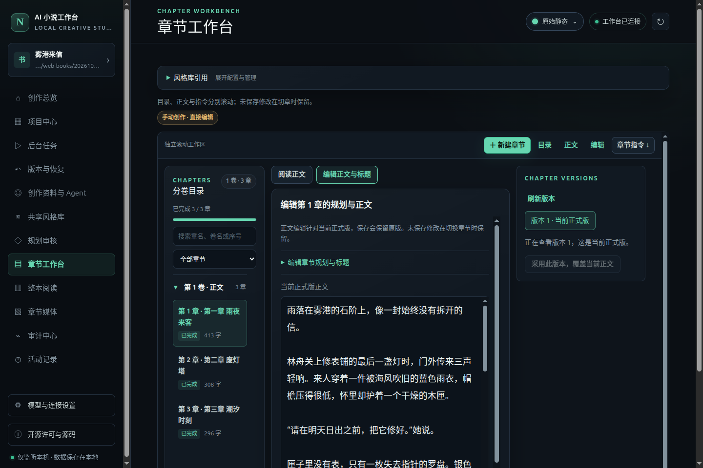
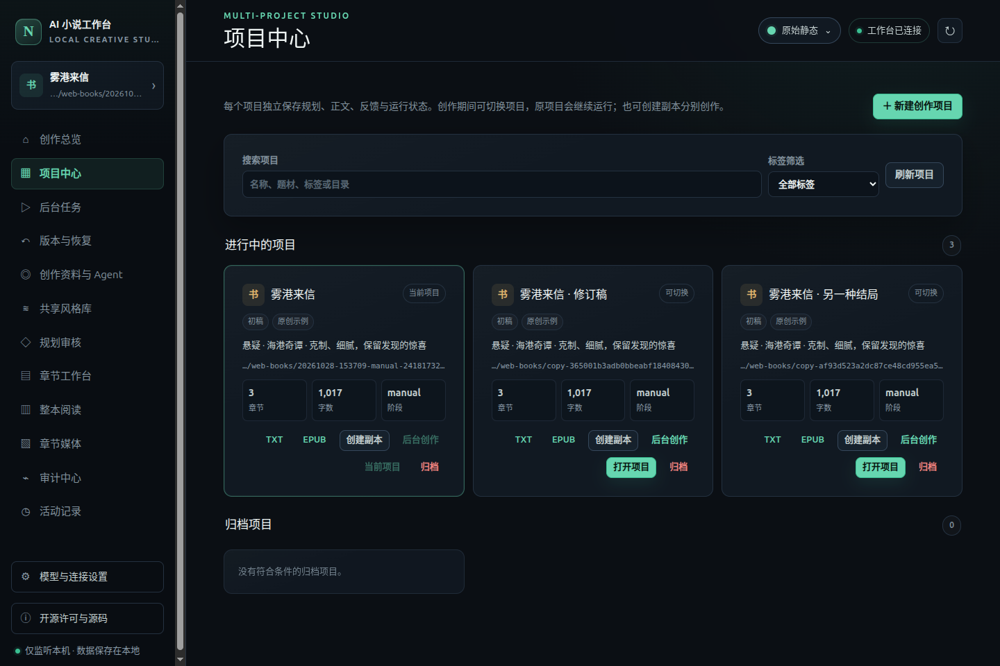
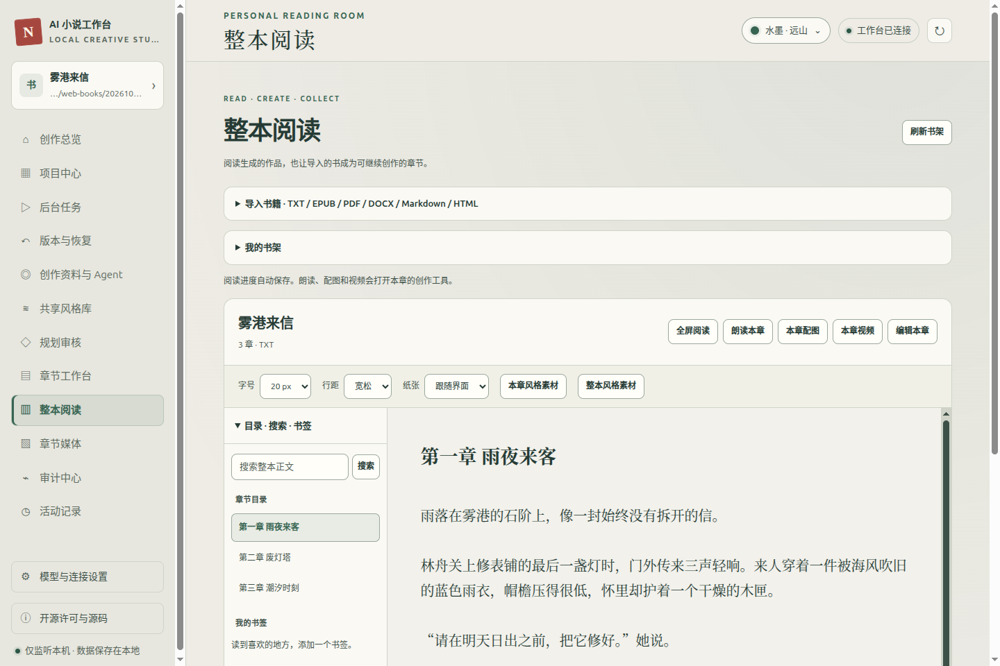
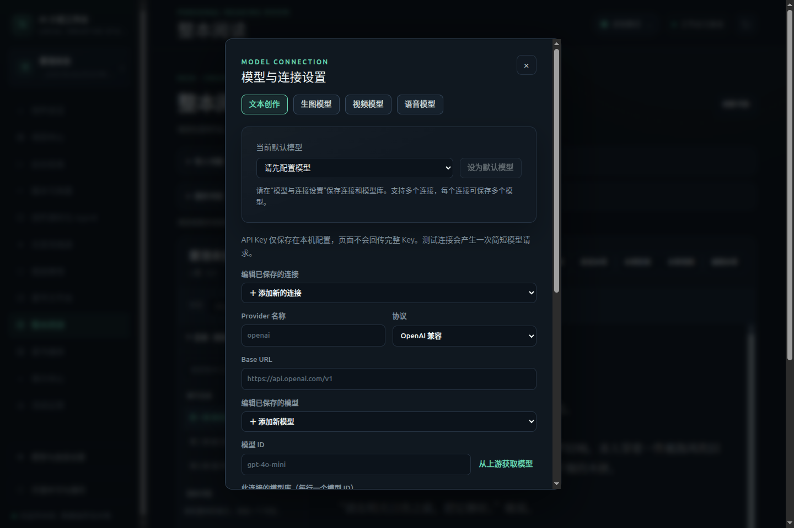
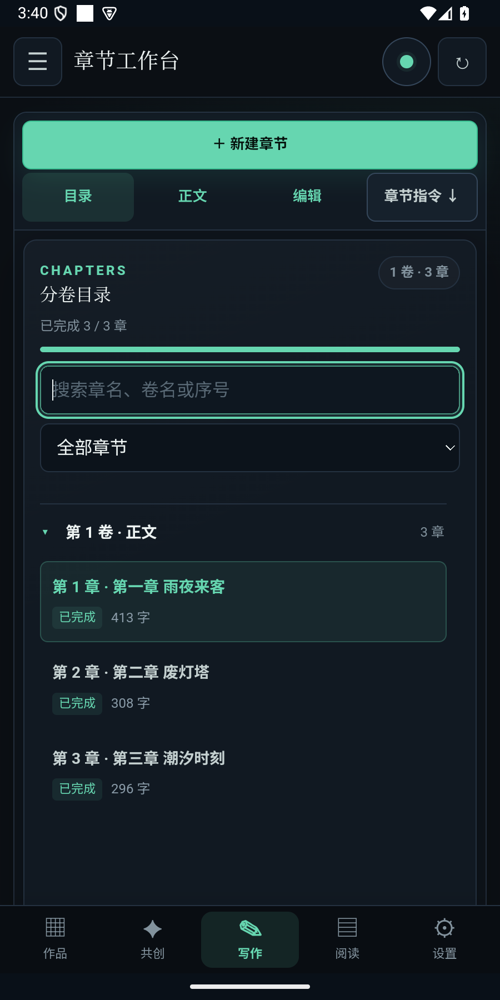
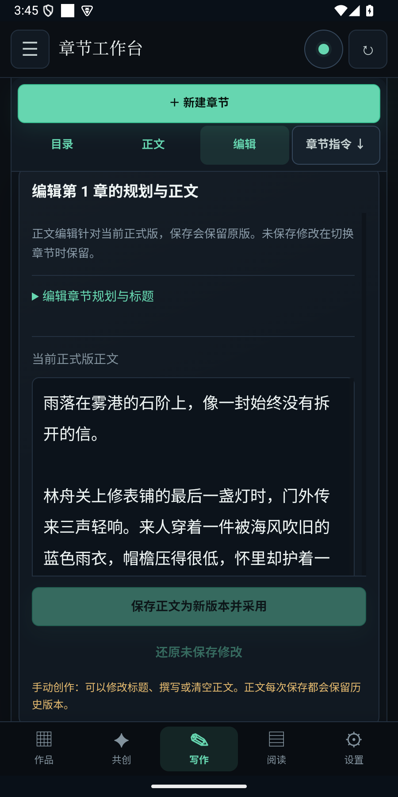
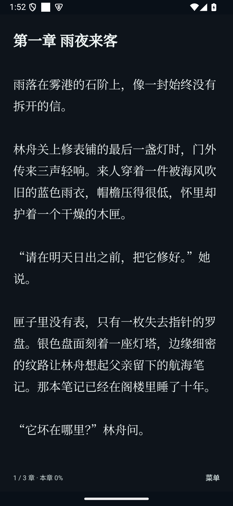
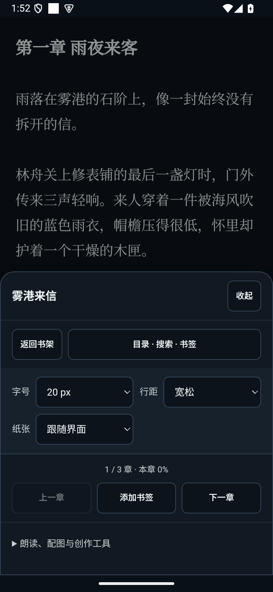
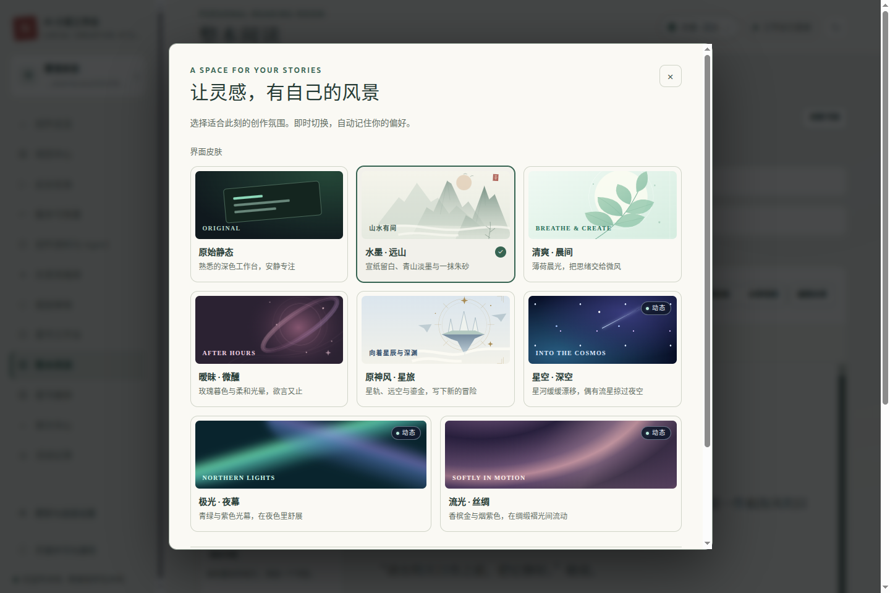

# OpenNoval · AI Novel Studio

**面向 Windows、Linux 和 Android 的本地小说创作与阅读工作台。**

从一句灵感开始，与 AI 共创设定、审核目录、分批生成长篇；也可以不配置模型，直接手动写作，或导入已有小说继续编辑和阅读。同一份正文连接章节版本、阅读器、配图、朗读与视频，作品和创作资料保存在本机。

[下载桌面版](https://github.com/hansshaw/OpenNoval/releases/tag/v0.1.3) · [下载 Android APK](https://github.com/hansshaw/OpenNoval/releases/tag/android-v0.1.1) · [界面预览](#界面预览) · [安装与升级](#安装与升级) · [本地开发](#本地开发与验证)

桌面端和手机端各自独立运行，安装后无需另装 Go、Node.js，也不需要手机连接电脑。手动写作、导入与阅读可离线使用；AI 功能使用你配置的模型服务和 API Key。Android 当前为预览版，作品暂不在设备之间自动同步。

## 项目特点

| 功能 | 可以做什么 |
| --- | --- |
| **可审核的 AI 长篇写作** | 多轮共创 → 设定与目录审核 → 分批生成 → 章节验收；按反馈重写，比较并采用候选版本 |
| **AI 与手动写作共用正文** | 无需 API Key 也能建书、创建章节、改标题与正文；已有小说可导入后继续创作 |
| **版本与草稿保护** | 保存正文保留历史版本；安卓为未保存修改保留本机草稿，正式版本变化时提示选择是否恢复 |
| **多格式整本阅读** | 导入 TXT、EPUB、PDF、DOCX、Markdown、HTML；支持目录、全文搜索、书签、进度、字号和全屏阅读 |
| **章节媒体与共享风格** | 按已保存正文生成配图、朗读和场景短片；从单章或整本语料分析写作风格，供多个项目引用 |
| **多项目管理** | 搜索、重命名、复制、归档、恢复；后台任务、并发额度、命名快照与差异预览 |
| **自选模型与本机数据** | 文本、生图、视频、语音分别配置连接与默认模型；项目、版本、书签和媒体保存在本机 |
| **桌面与手机界面** | 桌面分栏工作区，手机底部导航与章节分区；八款皮肤、可关闭的动态背景及系统文件导入导出 |

## 界面预览

以下为真实应用界面，使用虚构示例作品《雾港来信》。桌面图来自 Linux Electron 应用，手机图来自 Android 15 模拟器中的已签名 APK。点击图片可查看原图。

### 桌面端：章节创作工作台

目录、正文、编辑与章节指令集中在同一工作区，可按章节阅读、修改并保存版本。

[](docs/screenshots/desktop-writing.webp)

| 项目中心 | 整本阅读 |
| --- | --- |
| [](docs/screenshots/desktop-projects.webp) | [](docs/screenshots/desktop-reader.webp) |
| 管理独立作品，打开项目或导出 TXT / EPUB。 | 查看整本目录，调整阅读样式，继续编辑当前章节。 |

<details>
<summary>查看模型与连接设置</summary>

文本、生图、视频和语音各自选择模型连接，按实际使用的服务配置。

[](docs/screenshots/desktop-models.webp)

</details>

### Android App：手机写作与阅读

手机端提供底部导航、独立章节分区和系统文件选择器。作品在手机内保存，TXT / EPUB 导出通过系统“保存到”对话框完成。

阅读默认只显示正文与简洁进度栏，轻点正文中央或点击“菜单”调整字号、行距和纸色；目录、搜索与书签收纳到侧边菜单。AI 创作由后台服务执行，切换应用后继续，从最近任务中划掉应用则停止任务。

| 章节目录 | 正文编辑 | 整本阅读 |
| --- | --- | --- |
| [](docs/screenshots/android-chapters.png) | [](docs/screenshots/android-editor.png) | [](docs/screenshots/android-reader.png) |

<details>
<summary>查看手机阅读菜单与目录</summary>

| 点击正文中央展开设置 | 目录、搜索与书签菜单 |
| --- | --- |
| [](docs/screenshots/android-reader-menu.png) | [](docs/screenshots/android-reader-directory.png) |

</details>

## 阅读与导入

打开侧栏 **整本阅读**，选择书架上的作品，或展开“导入书籍”。导入会创建独立的手动项目；阅读器与章节工作台使用同一份正文，编辑后重新进入阅读器即可读到新内容。

| 格式 | 支持范围 |
| --- | --- |
| TXT | UTF-8、带 BOM 的 UTF-16、GB18030；识别常见中英文章节标题 |
| EPUB | 按书籍阅读顺序提取章节与标题；不支持 DRM 加密书籍 |
| PDF | 保留原页阅读，并提取文字为可编辑章节；可切换原页与文字模式 |
| DOCX | 提取段落、标题与正文；不执行宏 |
| Markdown / HTML | 提取可阅读文字；不执行脚本，也不加载文档中的远程资源 |

阅读器可独立调节字号、行距和纸张配色，保存章节进度与书签。导入的章节可直接打开 **朗读 / 配图 / 视频 / 编辑 / 风格蒸馏**。发送到风格库只添加语料，点击分析后才调用模型。

点击阅读工具栏的 **全屏阅读** 可展开正文和目录，文字模式与 PDF 原页均支持；按 Esc 或点击退出按钮返回，保留当前章节与阅读位置。

扫描 PDF 可以看原页，但当前没有 OCR；没有提取出文字的页面，需手动补充正文后再使用朗读、配图与风格蒸馏。PDF 复杂排版的提取顺序取决于文档文字层，原页模式用于保留原貌。EPUB、DOCX 和 HTML 的阅读模式侧重正文，不保留完整原版式。

每个导入文件最多 64 MiB，提取文字最多 32 MiB，PDF 最多 2000 页。单章正文与单篇风格语料上限均为 8 MiB。导入失败不会覆盖已有作品。

## 写作与章节工作台

在 **项目中心 → 新建创作项目** 选择创作方式：

- **纯手动创作**：立即进入章节工作台，点击“新建章节”开始写作，无需模型或规划审批。
- **AI 辅助创作**：先配置文本模型，完成共创和设定审核，再按批次生成正文。规划修改后重新审核；采用正文修订后同步章节事实，再继续生成。

目录、正文、编辑框、章节指令和整体工作区分别滚动，长篇正文不会把操作区推到页面末尾。顶部定位栏可直达各区域，窄窗会重新排列布局。未保存修改在切换章节时保留；保存正文创建版本，旧稿可查看和恢复。

项目支持 TXT、EPUB 导出与章节配图包导出。导出时使用项目锁读取一致快照；目标项目运行时须先暂停，其他项目可以继续创作。

首次启动直接进入项目中心，自行创建或导入作品，没有强制保留的默认项目。关闭后重新打开应用，会恢复上次选择的项目；项目已删除、归档或无法打开时回到项目中心。已有的旧版默认作品也可按归档、删除流程移除。规则审核、人物与世界设定、章节评审和事实记录以中文字段、分组卡片与列表展示，长内容可展开阅读。

## 模型、媒体与风格

**模型与连接设置**分为文本、生图、视频和语音四个独立面板，各自管理连接与默认模型。文本角色可配置专用模型和指令。

选择已保存的连接和模型即可修改配置。四类面板均可从上游获取模型列表，也可手动填写模型 ID；服务商目录可能包含多种能力，需选择支持相应用途的模型。

文本模型的上下文窗口与最大输出留空或恢复自动时，优先采用当前连接上游目录明确声明的参数；手动填写的数值优先，自动发现结果单独缓存，不会变成手动覆盖。部分服务商只返回模型 ID，不公开 token 限制，此时使用内置注册表或标为“未验证默认值”的回退，界面显示实际来源。模型目录查询不发起生成请求。

共创会为输出预留上下文空间，去除重复的旧草稿；长对话接近窗口时，将早期对话整理为可继续使用的摘要，保留最新草稿与最近轮次，原始历史仍保存在项目中。该流程借鉴 [OpenAI 的上下文压缩机制](https://developers.openai.com/api/docs/guides/compaction)，使用兼容不同服务商的本地会话管理。摘要会产生额外模型请求。遇到输出长度截断时只进行有界恢复；未完成的回复不会覆盖当前草稿。

章节媒体使用已保存的指定章节正文，支持 OpenAI 兼容的 Images、Videos、Audio Speech 接口；语音支持音色与长章分段，视频生成当前为 4 秒场景短片。自定义协议目前仅保存配置，实际生成需要服务商支持对应接口和模型。保存配置不会发起生成请求。

生成的图片进入本章配图，音视频可以播放、下载；也可导入本机图片，调整说明、顺序及章首/章尾位置。正文在生成期间变化时，旧结果不会自动关联到新正文。媒体产物随项目保存，重启后可继续查看。

共享风格库与界面皮肤分别管理：前者影响创作风格，后者只改变界面外观。风格分析可与创作并行，项目与模型请求各有并发额度；活动记录提供模型请求状态、用量与错误信息。

## 外观与可读性

八款可选皮肤：**原始静态、水墨 · 远山、清爽 · 晨间、暧昧 · 微醺、原神风 · 星旅、星空 · 深空、极光 · 夜幕、流光 · 丝绸**。

动态星群、极光和丝绸由本地 Canvas 绘制，装饰图形为原创资源。动画位于内容背后，不接管点击；正文、输入框和弹窗使用清晰底色。切换皮肤不刷新页面，外观偏好在重启后恢复。动态效果可以关闭，系统要求减少动态效果或窗口隐藏时暂停绘制。默认界面保持静态。

<details>
<summary>查看八款皮肤的实际选择界面</summary>

[](docs/screenshots/desktop-appearance.webp)

</details>

## 安装与升级

按平台下载对应安装包，已发布版本与验收范围见 [Releases](https://github.com/hansshaw/OpenNoval/releases)。

| 平台 | 当前下载 | 安装方式 |
| --- | --- | --- |
| Windows x64 | [桌面 v0.1.3](https://github.com/hansshaw/OpenNoval/releases/tag/v0.1.3) | 下载 `.exe` 安装包，按向导安装，可选择目录。 |
| Linux x86_64 | [桌面 v0.1.3](https://github.com/hansshaw/OpenNoval/releases/tag/v0.1.3) | 使用 `.AppImage` 或 `.deb`；AppImage 需先赋予执行权限。 |
| Android 8.0+ | [App v0.1.1 预览版](https://github.com/hansshaw/OpenNoval/releases/tag/android-v0.1.1) | 下载通用 APK，在手机打开并按系统提示允许安装。 |

首次使用可在“项目中心”新建纯手动项目，或在“整本阅读”导入已有书籍；使用 AI 共创前，先在“模型与连接设置”中配置文本模型。媒体功能需要对应服务商支持相应接口。

Windows 升级时退出应用，使用原账户和安装范围运行新版安装包，沿用原目录并保留用户数据，无需先卸载。Android 后续版本使用相同发行签名覆盖安装；卸载或清除应用数据会删除手机中的本地作品，请先导出重要正文。TXT / EPUB 导出不包含全部项目配置、历史版本与媒体，也不等同于完整项目备份。

Android 后台生成前，请在 **设置 → 后台运行设置 → 允许后台运行** 中完成系统授权；部分手机还需将应用电池策略设为“不限制”。普通返回键会退到后台，划掉最近任务会停止创作。系统强制停止、网络本身断开和后台时长限额仍可能中断任务。设备验收范围与使用说明见 [安卓开发文档](mobile/README.md) 和对应 Release。

## 本地开发与验证

需要 `go.mod` 指定版本或更新的 Go、Node.js 26、npm，以及可用的图形环境。

```sh
npm --prefix desktop ci
node desktop/node_modules/electron/install.js
npm start
```

```sh
go test ./...
go vet ./...
npm test
npm run smoke
npm run test:e2e
npm run dist
```

Linux 无图形会话时，在桌面测试前加 `xvfb-run -a`。安装包输出到 `desktop/dist/`；`npm run smoke:packaged` 检查打包产物。基础 CI 覆盖 Windows 与 Linux；手动桌面验收还检查打包运行、Windows 原目录升级和用户数据保留。

Android 的环境准备、构建和签名流程见 [安卓开发文档](mobile/README.md)，可使用 `npm run android:doctor`、`npm run android:build` 和 `npm run android:release`。

日常 push 不会自动发布 Release。为减少 GitHub 存储占用，工作流关闭依赖缓存和 Actions artifacts 上传；桌面打包仅手动触发，Android 在本机构建。维护桌面发行时可向手动工作流提供已有 Release 草稿 ID，版本、提交和验收匹配后直接上传安装包。

PDF 引擎及字体资源固定版本、离线打包，构建前检查哈希。更新资源时执行 `npm --prefix desktop run vendor:reader`，然后执行 `npm --prefix desktop run vendor:check`。更多环境、数据位置与测试说明见 [桌面开发文档](desktop/README.md)。

| 目录 | 职责 |
| --- | --- |
| `desktop/` | Electron、本机窗口与对话框、SQLite 索引、打包与桌面验收 |
| `mobile/`、`internal/mobilebridge/` | Android 应用、gomobile 绑定、本机服务、私有存储与 APK 构建 |
| `internal/entry/desktopui/` | 桌面界面、阅读器接口、项目与章节操作 |
| `internal/novelreader/` | 多格式导入解析、编码转换与文档边界校验 |
| `internal/host/`、`internal/engine/` | AI 创作调度、工作流与恢复 |
| `internal/store/`、`internal/projectjobs/` | 作品正文、规划、版本、事实与后台任务 |
| `internal/mediaworkspace/`、`internal/chaptermedia/` | 章节媒体生成、管理与导出 |

## 许可与数据

本项目由 **hansshaw** 维护，整体采用 [GNU AGPL 3.0](LICENSE)（`AGPL-3.0-only`）。第三方组件保留各自的版权和许可，必要声明集中在 [NOTICE](NOTICE) 与 [LICENSES](LICENSES/THIRD-PARTY.md)，并随安装包分发；应用侧栏可查看许可和源码入口。

正文、书签、媒体和项目状态保存在本机。模型 API Key 保存在本机配置，已保存的完整 Key 不回显到界面，也不写入桌面索引数据库；调用模型时，会将相应正文、指令或语料发送给你配置的服务商。仓库不包含模型服务，也不提供服务商额度。
