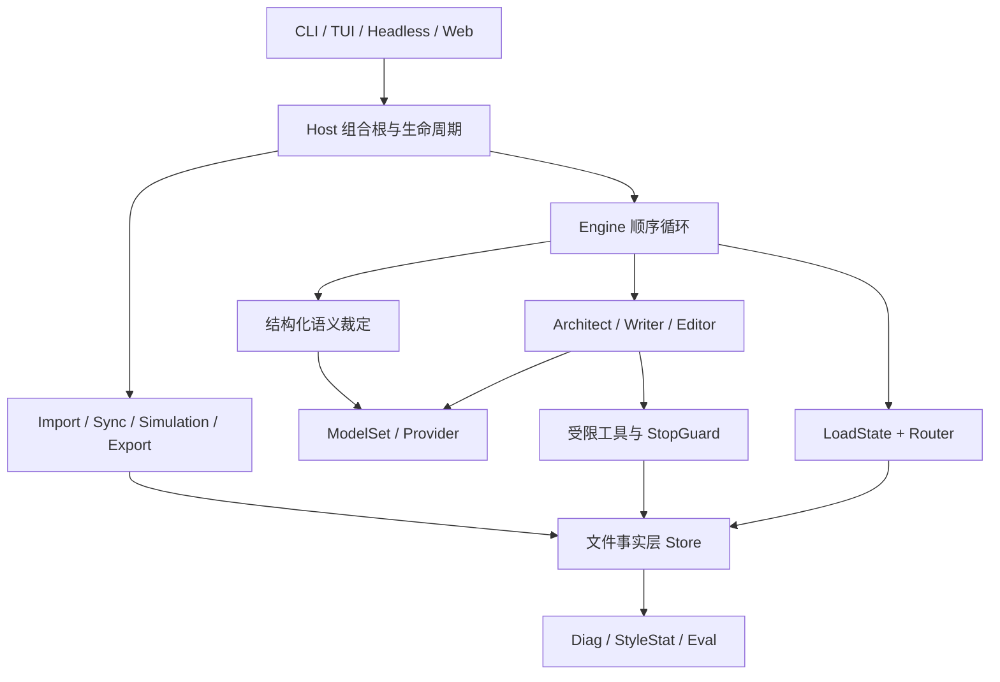
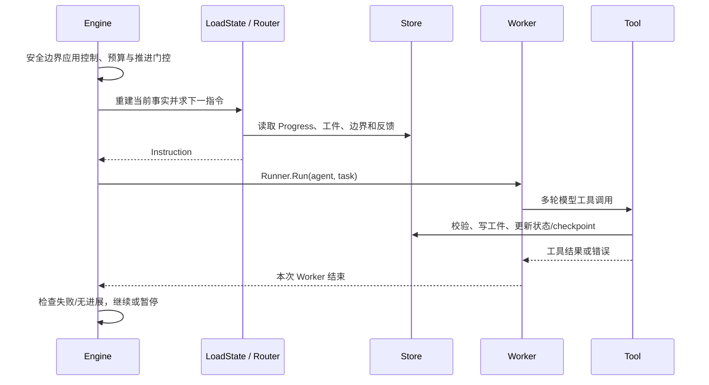

# ainovel-cli 项目架构与业务逻辑分析报告

分析日期：2026-10-20。代码基准：已提交的 `873d389`，加上本文对应的工作区增强改动。

本报告基于源码、现有测试、CI、内置 case、实际构建和本地 Web 工作台验收。Go 1.25.5 环境已配置；本轮已执行 `go test ./...`、`go vet ./...`、前端 JavaScript 语法检查和 Windows 二进制构建。真实模型生成闭环仍需要用户在界面中配置 Provider 与 API Key，因此工程质量结论与文学质量结论必须分开看。

## 1. 核心结论

项目是一个 Go 单机、本地文件驱动的长篇小说创作引擎，支持 TUI、headless 和本地浏览器工作台。确定性代码决定工作流，LLM 负责规划、写作、评审和语义裁定。它采用多个独立 Worker 身份，但一部书的 Engine 按安全边界顺序运行；不是分布式 Agent 集群。Web 层复用同一个 Host、Store、作品锁和恢复机制，并在其上增加项目管理、人工审批、逐章反馈、风格语料和审计视图。

核心设计可以概括为：**事实层确定，语义层自主**。flow.LoadState 从 Store 重建事实，纯函数 flow.Route 生成 Instruction，Host 调用 Worker，Worker 只能通过受限工具写入工件，工具追加 checkpoint 并更新进度。

项目最有价值的部分是可恢复工作流、章节接受基线、滚动卷弧规划、人机审批门禁和可审计的项目隔离。主要维护成本集中于 Host 生命周期、跨文件协调、上下文构建以及逐渐扩大的 Web/TUI 状态；内容语义正确性仍依赖模型判断。

## 2. 技术与目录职责

| 模块 | 责任 |
|---|---|
| cmd/ainovel-cli | 参数解析、版本、自更新、配置、模式分支 |
| internal/entry | TUI、headless、Web HTTP/SSE、首次启动与共创入口 |
| internal/host | 组合根、Engine、生命周期、预算、usage、锁、事件 |
| internal/flow | 事实状态加载与纯函数路由 |
| internal/arbiter | 启动规划、失败、用户干预的结构化语义裁定 |
| internal/agents | Worker 构建、工具白名单、上下文管理、StopGuard |
| internal/tools | 规划、正文、检查、提交、审阅、摘要工具 |
| internal/domain、chapterfacts | 状态、章节事实、卷弧、审阅和运行元数据 |
| internal/store | 文件 IO、子存储、投影、格式迁移、恢复记录 |
| internal/host/imp、revision | 外部作品导入与人工修改同步 |
| internal/host/sim、host/exp | 文风分析模拟与 TXT/EPUB 导出 |
| internal/diag、stylestat、eval | 诊断、跨章文风统计、离线评测 |
| assets | 内嵌角色提示词、协议与风格资源 |

Go module 声明 Go 1.25.5。主要依赖：agentcore 1.8.3、litellm 1.8.10、Bubble Tea 1.3.10、Bubbles 1.0.0、Lipgloss 1.1.0、flock 0.13.0。许可证为 Apache 2.0。

静态统计：325 个 Go 文件，其中 205 个生产文件、120 个测试文件；约 47,472 行生产代码、25,339 行测试代码，包含注释、空行与生成代码，不能视为覆盖率。internal 下有 24 个直接子目录。

## 3. 架构关系



这是主要协作关系，不是严格依赖 DAG。例如 revision 读取并重建投影，assets 装配也引用工具协议类型。Web 模式会运行一个只监听本机的短生命周期 HTTP 服务，但作品语义不依赖浏览器会话；持久状态仍位于各自的作品目录。单书 lease 阻止两个 Host 同时写同一目录；UI、metadata、usage、风格分析任务和干预可使用后台 goroutine，但主写作链按书串行。

## 4. 启动与运行生命周期

### 4.1 配置与入口

main 首先拦截 `eval` 子命令，再进入普通参数解析。一般运行依次处理版本、自更新、首次配置、配置加载和资源装配，最后选择 TUI 或 headless。配置分全局 `~/.ainovel/config.json` 与项目 `./.ainovel/config.json`；项目配置覆盖命名 provider/role 等字段，空字符串不能简单当成“清除继承值”。`provider` 是凭据配置的 key，模型协议由对应配置决定。

默认作品目录是当前 cwd 下的 `output/novel`。`--prompt` 和 `--prompt-file` 只用于 headless，二者互斥；prompt-file 为 `-` 可读取 stdin。不提供需求时尝试 Resume。TUI 提供快捷需求、共创、导入、修订、仿写、导出等命令；两种入口共用引擎，但并非所有操作都暴露为 headless 参数。`/start file` 读取的是创作需求，已有正文应走 `/import`。

### 4.2 Host 装配

`Host.New` 是组合根：

1. FillDefaults、验证配置，先取得书籍 lease。
2. 初始化日志和 Store，升级作品文件格式；当前为格式 3，未来版本拒绝打开。
3. 初始化 RunMeta、模型与定价元数据。
4. 加载 usage、必要时从 session 重放，启用自动保存。
5. 建立 Worker、style index、observer、预算和 advance gate。
6. 创建 Engine，向 TUI/headless 暴露事件与控制入口。

`StartPrepared` 在运行冲突、空需求、已有完成章节、预算等校验后启动新书；先保存原始 StartPrompt，再执行 arbiter 启动选型。decision 审计失败可 warning，但 PlanStartRecord 必须保存成功。这样首次规划没有落盘工件时仍可从需求恢复。

`Resume` 要求人工修改已同步，恢复持久干预与门控，刷新上下文并启动 Engine。运行态（idle/running/paused 等）与作品的 Phase/Flow 不是同一维度；终止进程也不等于删除作品事实。

### 4.3 Engine 一轮的动作



普通 worker 同一指令首次失败后先重试一次，再由 failure arbiter 选择 retry/reroute/abort。死锁按 Agent+Task 跟踪，连续到 3 次开始咨询，达到 5 次熔断；不同非语义故障有单独处理。这里“失败重试”和“连续无进展”是两个机制，不应混为无限自动重试。

## 5. 状态机与路由决策

### 5.1 三个状态维度

| 维度 | 主要字段/取值 | 意义 |
|---|---|---|
| 作品阶段 Phase | init、premise、outline、writing、complete | 基础建设/写作/完本 |
| 当前 Flow | writing、reviewing、rewriting、polishing、steering | 当前处理的是新章、返工或控制 |
| Runtime/RunMeta | running/paused、planning tier、PendingSteer、advance/hold/permit | 进程生命周期与用户意图 |

Phase 的普通更新单向前进；`/reopen` 是受控回退，使用 ReopenedFromComplete/ReopenCount 标识重新开放的完本。FlowReviewing 是保留分支：当前生产路径没有主动写成 reviewing，Editor 实际评审时 Flow 仍可为 writing。

Progress 保存 CompletedChapters、WordCounts、CurrentVolume/Arc、PendingRewrites、章节计划/场景进度、HookHistory/StrandHistory。NextChapter 根据最大已完成章节加一计算，不是运行时自由指定的游标。分层模式的 TotalChapters 含骨架估计，不是锁定最终长度。

### 5.2 Router 优先级

| 优先级 | 当前事实 | 下一动作 |
|---:|---|---|
| 1 | Phase complete | 返回空指令，宿主生成结束信息 |
| 2 | 未进入 writing 且基础缺失、已有 tier | 同一规划师补齐或审计 |
| 3 | 返工队列非空 | writer 处理队首 rewrite/polish |
| 4 | Flow reviewing | 返回空指令，当前保留态 |
| 5 | Flow steering | 控制处理期间让位 |
| 6 | 失效/缺失聚合工件 | editor 重建 review/arc summary/volume summary |
| 7 | 人工修订影响未传播到计划 | architect 消费外部反馈 |
| 8 | 分层弧已完成 | 弧审阅 → 弧摘要 → 卷摘要 → 扩弧/追加卷/完本 |
| 9 | 非分层审阅周期到达 | editor global review（每 5 个完成章节） |
| 10 | 非分层大纲耗尽 | architect 决定完成或续接 |
| 11 | 其他可写状态 | writer 写下一章 |

LoadState 负责 IO，Route 不直接读写文件，也不调用模型。首次基础空白且无 tier 时，Engine 用持久 StartPrompt 走 planStartFallback，而不是 Router 硬猜规模。

## 6. 核心业务：规划、写作、审阅与完本

### 6.1 规划如何转化为可执行事实

Architect 有 `architect_short` 和 `architect_long` 两个 Worker 身份，共享 architect 模型角色。它们通过 save_book、save_foundation、audit_foundation、expand_next_arc、revise_outline 等工具落盘书籍元数据、premise、角色、世界规则、大纲和 compass。

短模式使用紧凑平面大纲；中长模式使用卷—弧—章节层次，初始细化当前/首个弧，其余保留骨架。扩展基于上一弧实际摘要、角色快照、伏笔、世界状态和反馈。Compass 保存结局方向、活跃长线和规模估计。规划层不应覆盖已经接受的正文事实。

基础审计是模型对跨文件设定的语义检查，通过 fingerprint 绑定当前工件；代码保证审计对应同一组输入，模型决定是否协调。StopGuard 只保证规划产物落盘，Router 再通过 FoundationMissing 检查基础是否真正齐全。

### 6.2 Writer 的工具协议及其保障边界

推荐顺序为：`novel_context → read_chapter → plan_chapter → draft_chapter → 回读草稿 → check_consistency → commit_chapter`；返工可通过 edit_chapter 修改草稿。

| 动作 | 产物/作用 | 代码能证明什么 |
|---|---|---|
| novel_context | 按角色装配当前事实 | 提供事实包，不能证明模型已理解 |
| plan_chapter | drafts/NN.plan.json、Progress/checkpoint | 计划已落盘，章节目标合法 |
| draft_chapter/edit_chapter | 草稿与 draft/edit checkpoint | 正文已保存，尚未成为完成章 |
| check_consistency | 对照事实与草稿 digest checkpoint | 对照材料已返回，不能证明语义通过 |
| commit_chapter | 正文、accepted record、摘要、状态、Progress | 顺序/边界/事实结构与恢复协议通过 |

**关键区别：上述工具顺序是推荐协议，并非全部被提交工具强制。** 当前 commit_chapter 不核对 plan/consistency_check 前置 checkpoint；Writer StopGuard 只要求本轮出现成功 commit，在未完成时根据 draft/check 状态催促。因而“有检查点”或“有 commit”不能推导出模型真正审查过正文。这是可强化的协议边界，而不是本报告发现了某部书的实际质量故障。

commit 校验下一章、返工队列、写作阶段、分层边界、事实字段，以及伏笔推进是否引用本章可见的种植事实。重写必须正文或标题发生变化。字数由 utf8.RuneCountInString 统计，包含标点/空白，不是英语 word count 或严格汉字数。

### 6.3 评审如何触发返工

ReviewEntry 由 verdict（accept/polish/rewrite）、issues、维度分数、affected chapters 和总结组成。提示词定义七维审阅，但实际维度名可扩展；分数不替代 verdict 的业务裁定。

save_review 先原子更新 Progress 的控制状态，再写 review 工件和 checkpoint。第二步失败时返工意图仍在；Writer 排空队列后，Router 会因为 review 工件缺失重新派 Editor。聚合审阅拒绝非目标范围，同内容重试可补齐，不同已存内容拒绝盲覆盖。

弧尾 review、arc summary、volume summary 分别是不同任务，StopGuard 通过 Task 字符串识别需要落盘的产物。当前实现能阻止“被派生成卷摘要却只做 review 就结束”，但字符串识别对重命名敏感。

### 6.4 完本与 reopen

分层收官卷 final=true 提供明确终点；收官弧/卷的审阅和摘要补齐后可自动完成。手工 complete_book 至少要求 writing、有完成章节、无返工队列、无未写详细大纲、compass 活跃长线清空。不同路径的守卫不能泛化成“所有未收伏笔都由代码检查”。

/reopen 为完本开放受控修订，不应因修改旧章而额外续写新章；重返工完成后重新标记 complete，ReopenCount 使多次完成审计可区分。

## 7. 文件事实、提交恢复与人工同步

### 7.1 哪些数据是源，哪些是投影

| 对象 | 保存内容 | 地位 |
|---|---|---|
| ChapterFacts/ChapterRecord | 标题、摘要、人物、事件、伏笔、关系、状态；接受正文/hash/revision/origin/style | 章节接受基线与重建依据 |
| chapters/*.md | 当前可编辑正文 | 人工工作副本，可能与接受基线不同 |
| Progress | 已完成章、字数、队列、阶段、卷弧 | 调度事实 |
| RunMeta | 启动需求、规划选型、控制意图、推进策略 | 运行/恢复事实 |
| summary/review/world 状态 | 摘要、评价、世界投影 | 下游上下文与路由依据 |
| checkpoint | seq/scope/step/artifact/digest/time | 已落盘动作的证据 |
| session/usage/log | 模型调用、成本、运行事件 | 观测与成本恢复 |

不能把所有 Markdown 当缓存：premise.md 是设定源，chapters/*.md 是可编辑正文；outline.md、characters.md 等是结构化数据的人类可读投影。checkpoint 日志不包含全部正文与状态，系统不是纯 Event Sourcing。

### 7.2 实际文件布局

```text
output/novel/
  book.md                     # meta/book.json 的可读投影
  premise.md
  outline.json / outline.md
  layered_outline.json / layered_outline.md
  characters.json / characters.md
  world_rules.json / world_rules.md
  timeline.jsonl / timeline.md
  foreshadow_ledger.json / foreshadow_ledger.md
  relationship_state.json / relationship_state.md
  chapters/01.md
  drafts/01.plan.json / 01.draft.md
  summaries/01.json / arc-v01a01.json / vol-v01.json
  reviews/01.json / 05-global.json
  meta/
    book.json / progress.json / run.json / format.json
    compass.json / foundation_audit.json
    checkpoints.jsonl / decisions.jsonl / state_changes.jsonl
    chapter_records/000001.json
    pending_commit.json / pending_revision.json
    outline_feedback.jsonl / user_rules.json / usage.json
    snapshots/v01a01.json
    import/*
    runtime/queue.jsonl
    sessions/agents/*.jsonl
  logs/*
```

路径按 Store 源码整理，文件按所用功能生成，并非每部书启动时全部存在。章节文件名的两位补零是最小宽度，不限制到 99 章。

### 7.3 commit Saga

首次调用先冻结完整参数和 DraftContent，再进入以下持久阶段：

| 阶段 | 工作 | 中断后处理 |
|---|---|---|
| started | 保存正文、记录、摘要、事实增量 | 使用冻结载荷幂等重放 |
| state_applied | 标记 Progress、生成边界信息与输出 | 继续后续阶段 |
| progress_marked | 固化 result/output | 补 checkpoint |
| signal_saved | checkpoint 已存在 | 清理进行中状态与 pending |

恢复时不用模型新生成参数或被覆盖的草稿，避免“旧事实 + 新正文”。重写也冻结正文，但先构造候选记录集、验证事实链，再接纳并重建投影；不会仅覆盖正文而放任世界状态陈旧。

这保证常见进程崩溃后的可重放一致性，不代表事务回滚。Store.crossMu 是协调锁，多文件写入仍可中途失败；append/expand 的同输入幂等与投影修复，也不等于都拥有同样的 durable intent。IO 使用同目录临时文件、文件 sync、rename，但未显式 sync 父目录；突然断电耐久性需要文件系统和平台层验证。

### 7.4 人工修改与 /sync

Sync 先恢复 pending revision，扫描正文 hash 与 accepted record 差异。为理解后文影响，它倒序分析修改章，获得新的 ChapterFacts，再按章节正序验证并保存 pending：prepared → records_applied → projections_applied。投影重建会使受影响的 review、弧/卷摘要、snapshot 失效，并将后续计划影响写入 feedback。

写作前 requireCleanChapters 会阻止未同步修改。这是“人工编辑与模型事实分离”的必要协议；文件可编辑不代表进度和世界状态会实时自动更新。

## 8. 上下文、提示词和模型接入

### 8.1 分层记忆

Writer 上下文区分工作记忆、情节记忆与参考资源：当前计划/大纲/章节状态放在工作区，历史章节通过摘要、相关章建议、卷弧总结、人物快照和世界状态压缩召回。Architect 上下文聚焦基础设定、当前卷弧、compass 和计划偏差，不把所有正文塞入提示词。

ContextProfile 随规模缩小近期窗口：15 章以内 summary/timeline 窗口为 10/10，50 章以内为 5/8，超过 50 为 3/5。这个规模策略中的 Layered 标记与 Progress 的实际分层大纲状态是不同概念，不能据此断言超过 50 章自动完成模式迁移。较长作品还按伏笔、角色、状态、关系推荐相关历史；当前是结构化事实召回，未见向量数据库。

上下文管理使用 ToolResultMicrocompact、角色裁剪、Writer 的 StoreSummaryCompact，以及必要时 FullSummary。模型切换后按新窗口重建管理器；压缩后会补回计划/大纲/状态包。事实压缩能减少成本，但摘要遗漏仍会积累，最终质量需要跨弧评测证明。

### 8.2 资源覆盖与用户规则

角色协议、voice、style 和 references 由 go:embed 携带，可使用全局与作品级 style 资源覆盖；voice/anti-ai 追加、同名 style 替换。生产、测试、eval 共用 BuildWriterPrompt，当前签名是 writerPrompt、voice、style 三个参数。

用户规则从全局、项目和启动自然语言合成为本书快照；语义正规化失败可以保留原文降级，持久化失败会阻断。内置 lint 和结构化规则输出 violations，forbidden chars/phrases 标为 error，fatigue words 标为 warning；**规则 severity 不等于 commit 阻断**，当前 rules.Check 只返回事实，commit 将结果附在输出中。

### 8.3 模型契约

ModelSet 管理角色模型、Provider 与 failover，Worker 具备独立上下文和工具白名单。llmcontract.Execute 选择原生 JSON Schema 或 prompt JSON 契约：先 schema 校验再 DTO 解码和业务校验；prompt 模式结构错误及两种模式的业务错误会反馈给模型修正，直到成功或 context 结束。原生 schema 违约立即失败，schema 已通过但 DTO 解码失败视为代码契约问题。

因此应区分网络重试、格式自愈、业务纠错、Worker 重派四层循环。结构化函数没有统一固定纠错次数，超时和取消边界需要由调用方控制。

## 9. 用户控制、预算与观测

### 9.1 自然语言干预

用户干预不是直接拼进 Writer 聊天。Arbiter 根据 phase、flow、next、queue、checkpoint、近期决策和推进策略，生成独立可选的 Answer/Rules/Hold/Reopen/Dispatch。Host 按 answer → rules → hold → reopen → dispatch 执行；涉及运行任务的修改排到安全边界。事实已变化的 dispatch 会重新裁定，PendingSteer 持久化支持中断重放。

ChapterAdvanceGate 支持 auto/review，/next 只授权确切下一章；返工与恢复不会随意消耗新章 permit。hold 支持边界、返工排空、指定章后停止，控制意图跨重启保留。

### 9.2 成本

usage.json 是总量缓存，agent sessions 可按消息中的 provider/model 重放。成本依赖上游 usage 和定价；missing usage、零成本连续出现等情况有 warning。默认预算在 worker 边界停止，另有 hardstop 选项，因此预算是运行控制而非精确预付硬上限。Prompt cache 使用稳定书籍/角色/session 信息，但实际收益取决于 Provider。

### 9.3 观测不是控制源

observer 给 TUI/headless 转发事件、stream、工具详情和错误；显示层可截断，日志保留更多信息。事件 channel 与 stream channel 有界（100/256），满时丢弃旧项，不能把屏幕流当完整正文或审计记录。

diag 读取持久工件、sessions、logs，生成诊断与脱敏导出，不自动修复或改变调度。stylestat 统计跨章重复句式、词癖、结尾和标题等，达到样本阈值后反馈 Writer；它衡量风格信号，不等于文学质量评分。

## 10. 外围业务拆解

### 10.1 导入已有小说

导入是独立的语义编译流水线，不是放任一个 Import Agent 自由操作：

1. 读取源文本，按 UTF-8/BOM/GB18030 解码，只规范化换行并保存源快照。
2. 建立稳定行/分片坐标，由模型识别章节与附属文本边界，代码校验覆盖、顺序和 anchor。
3. 生成预览与确认工件；--yes 可自动接受，但有切分容错说明时必须人工核对。
4. 按模型窗口分批分析，再做 range digest 与整书综合。
5. 验证 foundation 和故事 open/closed/uncertain 状态，必要时由用户裁定。
6. 发布基础设定及原文章节，复用 ChapterCommit Saga；完成后默认 hold，显式 continue 才续写。

meta/import 保存 manifest、intent、source、guidance、segmentation、confirmation、analysis、synthesis、failure 等。NextAction 从工件/InputDigest 推断，UI stage 不是恢复依据。raw/normalized hash、prompt/semantic version 和模型预算身份使缓存可正确失效。

发布前的分析与验证在隔离 workspace 中完成，但 publish 本身是多步可恢复写入，可能已部分落盘，不能称为一次性全书原子导入。Engine 会拒绝在未完成导入上普通续写。输入处理针对文本，未见 EPUB/PDF 内容解析器。

### 10.2 文风模拟

Simulation 扫描 txt/md/markdown，按路径与 SHA256 跳过已分析资料，生成 source report 并合并为 SimulationProfile。单源超 60,000 rune 时保留头部约四分之三与尾部四分之一，中间截断。因此 profile 是采样后的风格分析，不是全本训练或模型微调。

Profile 以结构化风格指导注入 Worker。原文是分析输入，生成侧主要使用提炼结果；这与“导入正文后续写”是不同业务。

### 10.3 导出

Exporter 依据 Progress 选择已完成章，可指定范围；正文从 chapters/NN.md 读取，标题优先取已提交摘要，卷分隔来自分层大纲。支持 TXT/EPUB，目标已存在默认拒绝，显式 overwrite 才覆盖。读取的是当前章节文件，不能把它描述为强制从 ChapterRecord.Content 导出。

### 10.4 离线评测

正确入口是 `ainovel-cli eval --cases ...`，不带额外 run 子命令。支持 single、baseline/variant A/B、repeat、超时、章数上限、CI 静默模式、独立配置与 Markdown/JSON 报告。Baseline 使用内置资源避免本机覆盖污染；Variant 通过同一提示词装配入口替换。

指标来自 diag、case contract、stylestat、cost、tool count。退出码 0 为 PASS/WARN、1 为 case FAIL、2 为用法/配置错误。当前仓库只带 architect_short、architect_long、writer_first_chapter 三个 smoke case。虽然 schema 有 rubric 字段，LLM Judge 仍是后续层；不能宣称已经自动完成文学质量评测。

## 11. 本轮 Web 工作台增强

### 11.1 Web 是 Host 的本地操作面板

浏览器工作台没有另造一套创作引擎。`internal/entry/web` 把 HTTP/SSE 请求翻译为 Host 调用，并继续使用同一个作品 lease、文件 Store、Router、Worker、commit Saga 和导出器。主要接口分为：

| 能力 | 代表接口 | 服务端约束 |
|---|---|---|
| 状态与事件 | `GET /api/state`、`GET /api/events` | 状态脱敏；SSE 只承载最近事件，不承担事实持久化 |
| 创作控制 | `POST /api/action` | 动作白名单、JSON 限制、同源检查和暂停边界 |
| 项目管理 | `GET/POST/PATCH /api/workspaces`、`POST /api/workspaces/archive` | 目录必须位于允许范围，拒绝链接和目录穿越 |
| 规划审核 | `GET /api/planning` | 返回已落盘规划及规划 fingerprint，不返回 API Key |
| 风格分析 | `/api/style/*` | TXT/Markdown 大小与类型限制、项目切换取消、分析任务互斥 |
| 审计 | `GET /api/audit` | 返回接纳记录、摘要、评审、事实、决策和 checkpoint，不返回正文 |

前端通过安全 DOM API 构造内容，资源由 Go 二进制 `go:embed` 提供，部署只需一个可执行文件。默认绑定 `127.0.0.1:17680`，避免误用其他常见端口上已存在的应用。

### 11.2 项目隔离与配置覆盖

每个新项目有独立目录和 `meta/web-project.json`，保存题材、受众、人称、语气、目标规模、写作规则、风格、标签、Agent 模型、角色指令和归档状态。服务器持有全局基础配置 `baseCfg`，每次打开项目时克隆它，再叠加项目级 Provider/模型和角色指令。这样修改一个项目的角色模型或提示词不会污染其他项目，也不会把 API Key 写进项目资料。

项目切换要求当前 Host 停止、没有正在执行的动作和风格任务，并先构造候选 Host，成功后才替换旧运行态。旧项目关闭后，新项目重新加载自己的锁、进度、规划、反馈和章节状态。归档只改变项目可见状态，不删除作品目录。

需要明确的能力边界：

- 多个项目可以分别打开和继续，但服务器同一时刻只运行一个活动 Host；这是为了保持资源可控和单机操作边界明确。
- `AgentPreset` 目前主要进入项目创作 brief，用来表达协作方式和创作偏好；真正的 Worker 执行路径仍是 Architect / Writer / Editor 的固定职责与工具白名单，不是任意可编排的 Agent 图。
- `RoleModels` 可以分别覆盖 Architect、Writer、Editor 和导入语义函数所使用的模型；`RoleDirectives` 会追加到对应系统提示词，但不能覆盖安全边界、工具协议或审批门禁。

### 11.3 风格语料蒸馏

风格入口支持上传 TXT/Markdown，按文件和独立 Store 的 `simulate` 区域保存。分析任务复用现有 Simulation 管线：扫描、单源风格报告、跨来源合成、结构化画像。画像覆盖叙事声音、句式节奏、文字质感、视角、氛围和“不可复制项”等维度。单源过长时仍按既有策略截取头尾样本，因此它是“风格特征蒸馏”，不是全本训练，也不是模型微调。

上传、删除或重新分析会清理旧画像。只有当前存在且可加载的结构化画像才会进入后续创作上下文，避免删除语料后继续使用陈旧画像。分析期间项目切换会先取消并等待任务结束，降低跨项目串写风险。

### 11.4 大纲审批与逐章生成门禁

生成流程已经从“启动后自动写到结束”扩展为两个显式人工门：

```text
项目资料
  -> 生成 premise / 角色 / 世界规则 / 大纲 / 目录
  -> 用户阅读并提交规划意见
  -> Architect 修改规划
  -> fingerprint 匹配后点击“完全确认当前规划”
  -> 设置本批次 1–100 章并开始正文
  -> 每章 commit 后暂停
       -> 用户反馈：进入返工，旧验收失效
       -> 用户验收：保存 AcceptedChapter，继续下一章
  -> 批次结束暂停，等待下一次授权
```

`PlanningFingerprint` 把确认绑定到具体规划内容。项目资料、大纲、目录、角色、世界规则或影响规划的 Agent 配置变化后，旧 fingerprint 不再匹配，批次授权也会被清空。这个设计把“我看过旧规划”与“批准新规划”分开。

`BeginWorkbenchBatch` 只授权章号区间，不直接制造“已完成”事实。每章仍需通过正常 Writer 工具链、commit 校验、待重写队列清空和 commit checkpoint 检查，之后才能验收。验收是继续同批次下一章的前置条件。`RecordWorkbenchFeedback` 先持久化反馈，再把目标章节加入 rewrite/polish 队列；若章节已验收，会撤销该章验收。因此反馈不会被 Arbiter 降级成普通聊天回复。

审批和批次控制持久化在 `RunMeta.Workbench`，刷新浏览器或重启后仍可恢复。这里是人为流程状态，不会改写章节正文、ChapterRecord 或世界事实。

### 11.5 审计与故障定位

审计中心把分散文件整理成只读诊断视图：指定章节的接纳记录、摘要、事实增量、风格增量、评审、规划、角色、世界规则、时间线、伏笔、关系、状态变化、最近决策、checkpoint 和 Agent 配置。接口刻意不返回章节正文，也不返回 API Key；Web 错误文本也会遍历配置脱敏。

这套视图能回答“最后成功到哪一步、是否已接纳、有无返工、当前事实是什么、哪个 Worker 被派发”，但不能替代真实模型质量评估。SSE 活动流有容量上限，权威证据仍是 Store 中的工件和 checkpoint。

## 12. 工程质量与交付

| 项目 | 源码/配置可见情况 | 本次验证结果或边界 |
|---|---|---|
| Go 测试 | Router、StopGuard、agentcore、提交恢复、锁、导入、修订、导出、eval、Web API | `go test ./...` 通过 |
| 静态检查 | `go vet` | `go vet ./...` 通过 |
| 前端语法 | 原生 JavaScript，无构建步骤 | `node --check internal/entry/web/static/app.js` 通过 |
| Windows 构建 | Go 1.25.5 windows/amd64 | 成功生成 20,427,776 字节测试二进制 |
| Web 守护 | `internal/entry/web/server_test.go` | 覆盖项目切换、审批、批次、反馈、归档、风格源与审计等 API 行为 |
| CI | Ubuntu/Windows gofmt、vet、全量 test；Linux installer syntax/race | 本地通过；远端 CI 结果应以本次推送后的 GitHub Actions 为准 |
| 发布 | GoReleaser 覆盖多系统 amd64/arm64 与校验和 | 本轮只验证本机 Windows 构建 |
| 真实模型闭环 | 需要用户配置 Provider 和预算 | 本轮未用真实 Key 生成小说；界面已启动待验收 |

浏览器验收确认 `http://127.0.0.1:17680/` 返回 HTTP 200，标题为“AI 小说工作台”，页面不含 llama-ui 标识；桌面主流程、规划审核、章节工作台、审计中心和 390×844 移动视口均可操作，移动页面没有横向溢出，浏览器控制台无应用 JavaScript 错误。

这些检查证明构建、接口、确定性门禁和主要交互可用，不证明长篇文学质量、所有 Provider 兼容性或断电后的跨平台耐久性。后者仍需真实模型、长跑和故障注入。

## 13. 架构评价、产品改进与优先级

### 13.1 已有优势

- 纯函数 Router 使调度结果可复现；模型语义职责与可枚举规则分开。
- 章节接受基线、正文工作副本、世界投影分离，支持人工修订和重建。
- Saga/pending、工件 digest、lease 和 stale decision 提供明确恢复边界。
- 卷弧滚动规划和角色化上下文适合长篇持续推进。
- 单机文件产物可检查、可备份，TUI、headless 与 Web 复用业务核心。
- Web 项目隔离、规划确认和逐章验收把“能自动写”提升为“可控地写”。
- 审计中心把流程证据和生成内容分开，便于定位中断、返工和事实漂移。

### 13.2 技术与产品风险

下表是源码支持的维护风险或保障边界，不是已经复现的生产故障清单。

| 优先级 | 发现/证据 | 影响 | 建议与验证目标 |
|---|---|---|---|
| P1 | 推荐 plan/check 顺序并非全部提交前置守卫；check 只返回对照数据 | 完成态可能被误解成已审查 | 明确“检查执行”契约；若业务要求强制，校验当前草稿 digest 与检查证据，同时为导入保留显式通道 |
| P1 | Editor 以 Task 字符串判断摘要，Engine 以 Agent+Task 识别重复 | 文案改动影响控制行为 | 增加 TaskKind/Target，测试改动提示文本不影响调度 |
| P1 | bundled eval 只有三个 smoke case | 多弧、干预、审批和恢复缺少真实模型回归数据 | 补 recovery/steering/approval/longform case，故障注入验证事实一致性 |
| P1 | 当前只有一个活动项目 Host | 多项目可管理，但不能同时并行生成 | 若确有并行需求，引入后台任务队列、全局成本配额和每项目独立进程，先解决锁与资源公平性 |
| P1 | 风格画像是采样分析，没有来源段落级引用 | 难以解释某条风格结论来自哪里，也可能弱化原创边界 | 保存来源片段 ID、证据摘要和“禁止复制”检查，对相似句做确定性或检索式提醒 |
| P2 | host.go 约 1,996 行、commit 约 1,010 行，上下文/TUI 也集中 | 生命周期和跨域修改耦合 | 沿 control、lifecycle、commit replay、projection 拆分，保留外部接口 |
| P2 | 结构操作无统一 durable intent；IO 没有目录 fsync | 保障范围不一致 | 明确操作级恢复契约；对关键结构扩展补 intent/replay，按平台验证掉电耐久性 |
| P2 | JSON/schema 自愈可能持续到 context 结束 | 时间/成本难预测 | 给业务阶段设置可观测的次数、墙钟或预算边界 |
| P2 | usage/pricing 依赖外部，worker 边界结算 | 可能超出预算 | 展示成本可信度和最大调用窗口，保留缺失 warning |
| P2 | 项目、规划、风格和审计接口增加后，Web 层协调状态变多 | 切换、取消与事件串线测试成本上升 | 提取 ProjectCoordinator，给每次切换生成 generation id，围绕竞态补并发测试 |
| P2 | 文档路径/接口漂移 | 使用/排障误导 | 从常量与签名生成 manifest/示例并检查链接 |
| P3 | channel 丢旧 stream、长期事实/日志文件增长 | 展示缺片、读放大 | 保持工件权威；真实规模测量后增加索引、日志归档 |

文档漂移的具体例子：docs/observability.md 把 layered_outline/characters 写在 meta 下，而 Store 实际存于作品根；docs/voice-layer.md 展示四参 BuildWriterPrompt，而当前源码为三参。FlowReviewing 的保留语义也应在业务文档明确。

### 13.3 UI 使用便捷性建议

1. **把工作台改成任务导向首页。** 首屏直接展示“待确认规划、待验收章节、待处理返工、待配置模型”，用户不需要先理解 Architect/Writer/Editor。高级面板再显示 Agent 细节。
2. **规划审核采用版本并排比较。** 左侧显示旧版，右侧显示新版本，按 premise、角色、世界观、卷弧、章节目录分组差异；每类可单独接受或退回，而不是每次全量重新确认。
3. **正文采用编辑器工作区。** 提供章节树、正文、反馈、评审、事实和引用素材多栏布局；反馈定位到段落，支持选区评论、整章意见和只重写选中片段。生成前后使用 diff 展示改动。
4. **增加故事控制台。** 人物关系图、伏笔看板、时间线、地点/势力、角色状态变化和章节目录应共享筛选与跳转。点击伏笔可查看种植、推进、回收章节及当前风险。
5. **增加规划 Lint 面板。** 在确认前自动检查：章节目标是否重复、角色是否长时间消失、卷弧是否无冲突升级、伏笔是否超期、目标字数与章均字数是否矛盾、事件时间是否冲突。Lint 是事实提示，不应默默替代用户批准。
6. **增加任务与成本可观测性。** 展示当前项目、Agent、章节、调用次数、token、估算成本、耗时和重试原因；支持按项目设置预算、软暂停和硬停止，并提供“为什么现在暂停”的可读解释。
7. **强化可恢复操作。** 每个失败卡片应提供“继续、重试当前步骤、回到上一个安全点、导出诊断包”，并明确操作会改动哪些文件或使哪些审批失效。
8. **改善多项目操作。** 增加项目看板、状态筛选、最近活动、批量归档和项目级备份；如果以后支持并行任务，显示每个项目的执行槽和全局资源占用。
9. **减少输入负担。** 项目新建采用模板和分步向导，可保存题材模板、Agent 团队模板、写作规则模板；常用动作提供命令面板和键盘快捷键。
10. **保持移动端只做轻操作。** 移动端适合审批、查看章节、填写反馈和暂停；长篇编辑、版本比较和高密度关系图可提示转到桌面端。

### 13.4 业务功能升级顺序

1. **先建立 Story Bible。** 把 premise、角色、地点、势力、规则、时间线、关系、物品、伏笔和章节事实做成统一可检索、可版本化的业务视图。现有 Store 已具备大部分数据，重点是投影、校验和 API，不需要先上数据库。
2. **再补规划工作室。** 支持主题/卖点/角色弧/卷弧/章节卡分层编辑、独立性检查、因果链和冲突节奏图；规划修改显示影响的章节范围，用户可按范围重生成。
3. **建立差分重写。** 复用 revision 和章节接受基线，支持选区级重写、章节级重写和设定变更影响的批处理。每次重写形成可回退版本，不直接覆盖已接受事实。
4. **增加素材 RAG。** 将作者授权的设定集、资料、访谈、历史材料和风格语料切分、标注来源并提供段落引用。正文召回必须区分“事实依据”“风格参考”“禁止复制内容”。
5. **形成质量审计流水线。** 机械校验事实字段和禁用规则；检索校验人物、时间、地点、伏笔；LLM Judge 评估节奏、人物、审美；最后由用户审批。不同证据分级展示，避免用单一总分掩盖问题。
6. **多 Agent 真正的差异化。** 支持项目级 Agent 团队模板，例如主线规划师、人物弧编辑、世界观审校、悬疑伏笔编辑、风格写手和连续性审计员。每个角色需要独立输入范围、工具权限、模型、预算和输出 schema，不能只是追加一段提示词。
7. **原创与合规保障。** 上传文本应记录授权来源，风格分析输出“抽象特征”而非可复制长片段；发布前提供相似句检索、来源提示和人工复核入口。
8. **评测与运营。** 建立按题材、篇幅和 Agent 模板的回归集，记录事实漂移率、返工次数、审批通过率、每千字成本、跨章重复句和读者反馈。没有离线基线和真实长跑数据前，不宜宣称“全自动高质量”。

第一阶段先补契约与证据：TaskKind、工具链保障说明、artifact 路径文档、典型 Router/commit/reopen/import 回归。验收应检查最终正文 hash、accepted facts、Progress、pending 清空、checkpoint 与投影一致。

第二阶段补集成恢复：在 Saga 各阶段注入失败，覆盖导入部分发布、修改早期伏笔、返工队列、stale intervention、plan approval/batch/chapter gate、跨进程 lease 和 Provider failover。

第三阶段做长篇质量评测：以 5–20 章及多卷/多弧样本运行 repeat，分别观察确定性门禁、摘要事实漂移、角色/伏笔召回、风格变化、成本和工具调用。Judge 可作为附加证据，不能替代事实门禁。

数据库、Vector Store 或分布式调度应在数据规模和真实性能问题出现后决定。当前单书串行是保持因果一致性的设计选择，不是首要待修复的不足。

## 14. 是否使用 LangChain、LangGraph

### 14.1 结论

不建议用 LangChain 或 LangGraph 重写现有 Go Host、Store、Router 和章节提交链。项目真正的护城河是确定性事实层、lease、幂等恢复、章节接受基线、审批 fingerprint 和审计，这些能力不能由 Agent 编排图自动获得。若立刻整体迁移到 Python 框架，会先丢掉已经验证过的可靠性，再重新实现一次。

建议把框架作为可选的“能力扩展层”，按业务需求引入：

| 需求 | 建议框架 | 原因 |
|---|---|---|
| TXT/PDF/网页/数据库资料导入、切分、Embedding、RAG、来源引用 | LangChain | 文档加载器、splitter、retriever、vector store 和 evaluator 生态成熟 |
| 研究资料收集、多个分析角色动态分支、复杂人工审批图、可恢复的长流程实验 | LangGraph | 图状态、条件边、interrupt/checkpoint 和子图适合显式工作流 |
| 当前大纲、逐章写作、事实提交、返工和完本 | 现有 Go Engine | 已验证的串行事实权威、Saga 和工具白名单更直接可控 |
| 角色提示词、模型路由和基础命令 | 现有 Agent/ModelSet | 引入 LangChain 不会带来足够收益 |

### 14.2 推荐集成方式

采用“Go 主控 + Python sidecar”：

1. Go Host 仍是唯一事实权威，负责项目锁、章节接纳、审批、预算、正文写入和恢复。
2. Python 服务只接收明确输入，返回结构化 JSON，例如“资料切片及来源 ID”“风格画像及证据”“研究计划”“多角色评估结果”。
3. 每次 sidecar 调用带 workflow id、输入 digest、prompt/version 和预算；结果落盘后由 Go 做业务校验。
4. LangGraph 的 checkpoint 只能作为 sidecar 内部工作流恢复点，不能取代 Store 的章节接受基线和 commit Saga。两侧通过幂等任务 ID 对齐。
5. 先做离线批处理和 RAG，再考虑在线动态图。第一阶段不需要让 LangGraph 直接控制 Writer 的逐章循环。

### 14.3 何时才值得正式引入 LangGraph

满足以下两个以上条件时，再建立 LangGraph 子流程比较合理：

- 素材来源超过三种，需要检索、去重、引用和跨来源冲突消解。
- 一个规划任务会出现用户可修改的动态分支，且分支状态需要多轮恢复。
- 需要把“研究、提案、反证、修订、审批、发布”拆成多个可观察节点。
- 多个评估 Agent 需要并行或条件路由，并输出统一 schema。
- 团队希望用 Python 生态快速试验，而不愿持续修改 Go 控制流。

即使引入 LangGraph，也应保留当前 Web 工作台作为人工操作入口，把审批结果写回 `RunMeta.Workbench`。这样可以先比较 sidecar 方案的质量、成本和失败率，再决定是否扩大使用范围。

## 15. 源码导航与核对入口

以下路径相对本报告所在 docs 目录。行号会随改动变化，核对时以文件中的类型和函数名为准。

| 问题 | 源码入口 |
|---|---|
| 程序如何启动 | [main.go](../cmd/ainovel-cli/main.go) |
| Host 如何装配/开书/恢复 | [host.go](../internal/host/host.go) |
| 每一轮如何运行 | [engine.go](../internal/host/engine.go) |
| 事实如何转换为下一任务 | [state.go](../internal/flow/state.go)、[router.go](../internal/flow/router.go) |
| 状态对象是什么 | [runtime.go](../internal/domain/runtime.go)、[revision.go](../internal/domain/revision.go) |
| Worker 如何获得权限 | [build.go](../internal/agents/build.go) |
| 什么情况下允许退出 | [subagent_guards.go](../internal/agents/guard/subagent_guards.go) |
| 上下文与召回 | [novel_context.go](../internal/tools/novel_context.go)、[context_manager.go](../internal/agents/context_manager.go) |
| 章节如何提交与恢复 | [commit_chapter.go](../internal/tools/commit_chapter.go) |
| 一致性检查究竟做什么 | [check_consistency.go](../internal/tools/check_consistency.go) |
| Review 如何形成返工 | [save_review.go](../internal/tools/save_review.go) |
| 文件布局与 IO | [store.go](../internal/store/store.go)、[world.go](../internal/store/world.go)、[io.go](../internal/store/io.go) |
| 接受基线和检查点 | [chapter_records.go](../internal/store/chapter_records.go)、[checkpoints.go](../internal/store/checkpoints.go) |
| 人工修改如何传播 | [service.go](../internal/revision/service.go) |
| 用户干预如何裁定 | [intervention.go](../internal/arbiter/intervention.go) |
| 导入如何切分/恢复/发布 | [imp/runner.go](../internal/host/imp/runner.go) |
| 仿写如何分析 | [sim/runner.go](../internal/host/sim/runner.go) |
| 导出取什么正文 | [exporter.go](../internal/host/exp/exporter.go) |
| 模型契约如何自愈 | [execute.go](../internal/llmcontract/execute.go) |
| 机械规则是否阻断 | [checker.go](../internal/rules/checker.go) |
| Web API 与项目切换 | [server.go](../internal/entry/web/server.go)、[projects.go](../internal/entry/web/projects.go) |
| 规划审批、批次和逐章验收 | [workbench.go](../internal/host/workbench.go) |
| 风格语料上传与分析 | [style.go](../internal/entry/web/style.go)、[sim/scanner.go](../internal/host/sim/scanner.go) |
| 审计只读视图 | [audit.go](../internal/entry/web/audit.go) |
| 评测与测试保障 | [eval.go](../internal/eval/eval.go)、[CI](../.github/workflows/ci.yml)、[smoke cases](../evals/cases/smoke) |

## 16. 规划与模型边界改进验收（2026-10-20）

本轮针对真实生成中最容易出现、又不容易从界面直接判断的三类问题做了收口：模型上下文与输出预算没有形成明确契约，Provider 因 `max_tokens` 过大拒绝请求或截断时缺少诊断，以及结构损坏但仍是合法 JSON 的规划可能被写入事实层。

### 16.1 上下文窗口与单次输出上限

`providers.<name>.models[]` 现在同时支持：

- `context_window`：模型总上下文窗口，用于本地压缩阈值和容量判断。
- `max_output_tokens`：单次请求允许生成的输出上限，会作为 `max_tokens` 传到模型请求边界。

解析规则如下：

| 限制 | 优先级 | 最终兜底 |
|---|---|---|
| 上下文窗口 | 模型配置 → 旧版全局配置 → 内置注册表 | 200,000 token |
| 单次输出 | 模型配置 → 内置注册表 | 16,384 token |

输出上限会静态限制在上下文窗口以内。业务任务显式设置的 `WithMaxTokens` 仍然优先，避免统一模型上限覆盖结构化裁定、摘要等更小的任务预算。

Web 设置页新增两个数字字段和“当前生效值/来源”提示。从上游获取模型列表时，会同时解析 `context_length`、`max_completion_tokens`、`max_output_tokens`、Gemini `inputTokenLimit` 和 `outputTokenLimit`；上游未提供时再查内置注册表。保存当前模型限制只修改该模型，不覆盖同 Provider 的其他模型、API Key、fallback 或角色配置。

### 16.2 截断诊断

当 Provider 返回 `stop_reason=length` 时，审计活动流会产生唯一一条 `output_truncated` 警告，记录 Provider、模型、实际输出 token、生效上限、上限来源和上下文窗口。该警告不会把 Agentcore 的自动续写误判成最终失败，但会明确提示正文或工具参数可能不完整，需要人工检查。

### 16.3 规划落盘前结构校验

`save_foundation` 在写入大纲前增加了确定性校验：

- 扁平大纲不能为空，章号必须从 1 连续递增，每章必须有 `title`、`core_event` 和 `hook`。
- 分层大纲至少包含一卷、每卷至少包含一弧，卷标题、弧标题和弧目标不能为空。
- 首卷首弧必须已经展开为详细章节，不能只保存骨架。
- 未展开的骨架弧必须给出有效的 `estimated_chapters`。
- 校验失败时拒绝写盘，避免“JSON 可以解析，但内容已被截断”的规划进入事实层。

工具结果同时返回 `arcs`、`skeleton_arcs` 和 `missing_scenes`，便于 Agent 与界面识别规划完整度。

### 16.4 当前服务与验收

Web 工作台已使用最新二进制启动：

```text
http://127.0.0.1:17680/
```

启动日志位于：

- `output/local-test/ainovel-web.stdout.log`
- `output/local-test/ainovel-web.stderr.log`

本轮验证结果：

- `go test ./...`：通过。
- `go build ./...`：通过。
- `node --check internal/entry/web/static/app.js`：通过。
- `desktop/npm test`：3/3 通过。
- 首页返回 HTTP 200，标题为“AI 小说工作台”。
- `/api/config` 能返回每个模型生效的上下文窗口、输出上限及来源，不返回 API Key。
- `git diff --check`：通过。

### 16.5 仍需明确的能力边界

- `context_window` 控制本地上下文压缩时机，不直接改变上游模型的真实请求窗口。
- 当前没有按实时 prompt token 数动态扣减输出上限；若 prompt 已接近窗口边界，Provider 仍可能拒绝请求。
- 显式任务级 `WithMaxTokens` 优先于模型级输出上限；新增任务预算时应同时检查任务调用点。
- Agentcore 会尝试恢复长度截断，但截断后的正文、JSON 工具参数和文学连贯性仍需人工审阅。
- 中转代理、本地模型和私有模型若不在注册表中，可能显示 200K/16K 的未验证默认值；应在设置页填写上游文档给出的真实限制。
- 本轮改动仍在本地工作区，尚未提交或推送远端；验收后再决定提交信息与发布时机。
